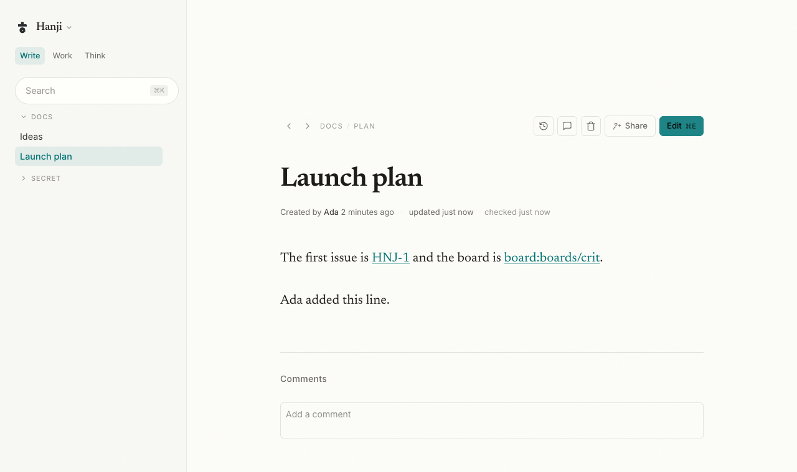
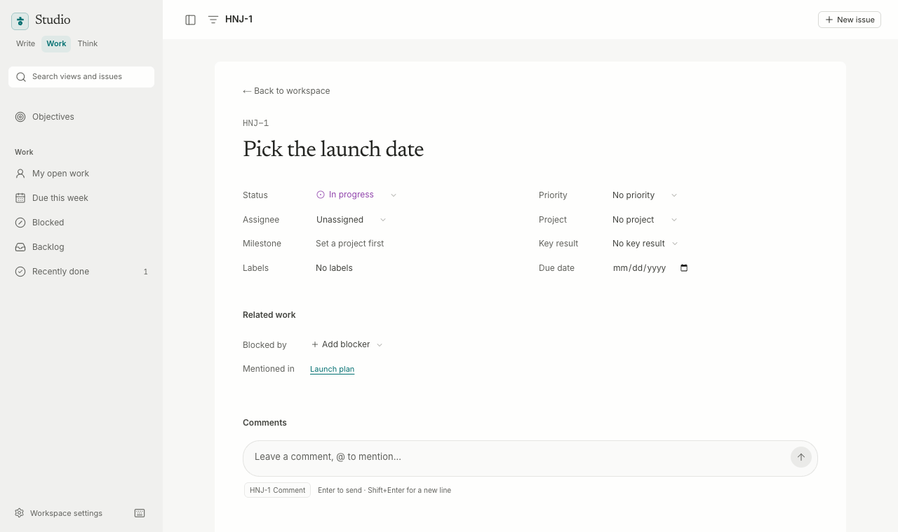
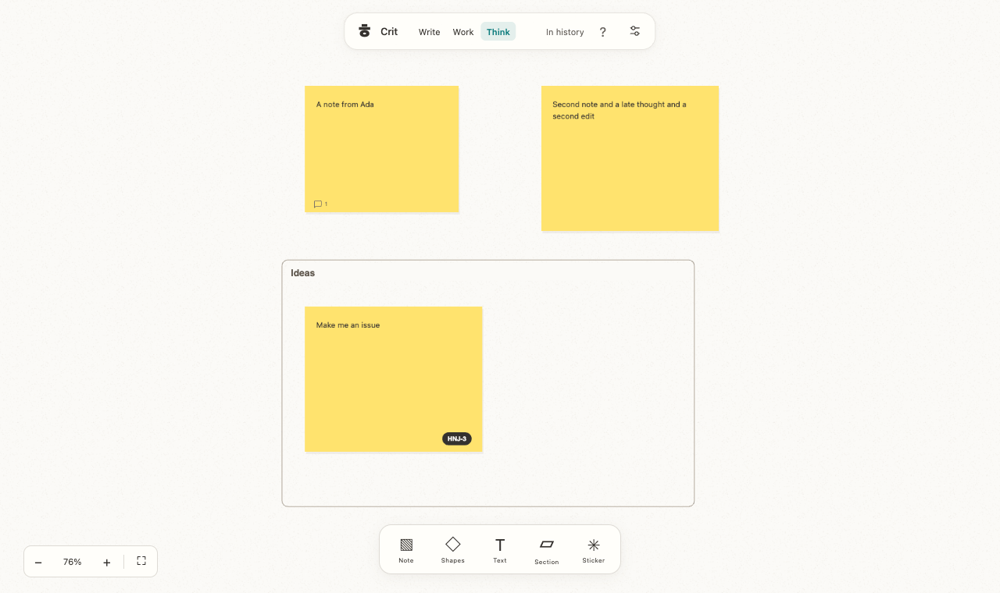

---

title: Changelog
order: 130
description: The road behind us, honestly logged.
---

# Changelog

## 2026-11-05 — A handbook made for finding and reading

The public handbook has a compact header, a page-title finder, a readable guide hierarchy, an on-page outline, stable section links, Markdown source links and previous/next navigation. The start page offers a clearer route into each product. A new Planning work guide covers everyday tasks, focused agent mentions and project-wide help. Mobile keeps navigation and the outline in native collapsible panels. Themes and reading still work without JavaScript; search filters only already-published page titles and sections.


## 2026-11-05 — Restore the research lab's purpose

The public introduction and brand guides now explain Hanji as a thin interface between people and agents, with clarity supporting human judgment. The story includes its personal origin, ongoing iteration and public, open-source sharing. The workspace is presented as a current expression of that research.


## 2026-11-04 — A clearer introduction to Hanji

The public introduction now starts with the mission and the workspace as a whole. A new **From idea to action** guide follows a fictional decision across Think, Plan and Document. Product captures use higher-density rendering. Installation and conductor guides put practical tasks ahead of appearance customization.


Reverse chronological. Struck-through text is a decision we made and then moved past, kept visible on purpose, because a changelog that hides its own wrong turns is just marketing.

## The public story catches up with the workspace

- The landing page presents Think, Plan and Document together, with a dedicated Think page, current product captures, the shared conductor, insights and onboarding.
- The five language routes use the current product names. Previous Write, Work, Knowledge and Tracker URLs continue to redirect with query strings and anchors preserved.
- The public handbook adds Desktop workspace and Workspace insights, refreshes Start here, Quick start and Features, and documents Think as a workspace surface. Package names and CLI identifiers remain stable.
- Public handbook image paths resolve in the static export, and its theme picker shares the marketing site’s saved System preference before first paint. On phones, native collapsible navigation keeps the article near the top; keyboard readers have Skip to content.
- Availability stays explicit: an invited Mac preview, separately configured agent accounts, and no public binary download or hosted workspace service.

## A smoother first workspace

- Four named stages cover the workspace and its products, content, owner access and a final review. All products begin selected. Import details appear only when needed.
- Start fresh creates local repositories for the selected products inside the workspace data folder, with an editable welcome page in Document. Existing folders are preserved; failures roll back newly created folders and mounts before the owner is stored.
- Setup keeps the workspace name and product choices across a reload, never passwords. Inputs have labels, errors stay in place, each step receives keyboard focus, and local setup help opens without leaving the flow. Small screens, dark mode and reduced motion are supported.
- The desktop’s empty workspace home has a clear Create your workspace action. A shareable preview pack includes the app, an Applications shortcut, a Start here guide and a SHA-256 checksum. Packaging does not publish or claim notarization; public downloads remain unavailable until a release is made.

## Canvas tools with a considered place to open

- Timer and voting open in an anchored session panel with clear tabs, duration presets, a large shared countdown and stable vote controls. Escape and outside clicks dismiss it; an active status chip reopens the relevant tool.
- Templates use a visual dialog with a distinct bulk-note flow and clear insertion actions. Help has searchable, grouped shortcuts. Canvas settings open in a drawer over the live canvas, preview its background, and protect unsaved drafts.
- The four surfaces share focus return, close controls, keyboard tabs, responsive bounds and reduced-motion support. Plan’s New issue action now uses the same light primary treatment as New canvas.

## Workspace insights without the cold-open wait

- Activity opens an authenticated, usable shell before reading history. Scoped journal data loads separately with retry and timeout handling; independent readable repositories are discovered concurrently.
- The overview adds a seven-day comparison, recorded contributions, active days, busiest day, product mix and human/agent attribution. Counts describe recorded work, not time saved or productivity; capped history is labeled.
- Product charts drill into bookmarkable filters. Filter changes and browser Back update data in the same document. The journal, historical pagination, permissions and seen position remain intact.

## Reliable view switching and canvas presence

- Product activation restores visibility immediately. A hidden WebKit view no longer needs an animation-frame callback to recover from a dimmed transition; root transforms no longer trap fixed controls.
- Think’s tool-activity badge and target cursor use the workspace conductor shape, primary color and state motion. Approval stays still; reduced motion and off-screen behavior remain intact.

## A quieter conductor picker

- Keep Orb, Ring, Crystal, Blob, Cube and Disc; remove the other shape choices and Float motion.
- Smaller shape previews sit above four keyboard-accessible state tabs. Each tab names its motion and reveals a focused preview with direct motion choices.
- Existing retired shapes fall back to Orb; Float becomes Gentle sway, preserving the rest of the saved preferences.

## Completed binary key results stay complete

- Completed binary key results no longer show Update due or inflate the overview’s check-ins-due count when their last check-in ages.
- Unfinished and reopened binary results still need fresh check-ins. Metrics keep their freshness checks even at 100%, including recurring monthly measures.

## Cooler surfaces and a shaped conductor

- Document, Plan, Think, shared search, the conductor and desktop shell use calmer cool neutral paper, sheets, navigation and borders in light and dark. Workspace accents, status semantics and sticky colors remain distinct.
- The conductor replaces its dot with a locally bundled Solids shape in the workspace primary color. Settings, Appearance offers twelve geometry previews and separate motions for paused, open, active and working states.
- Saved preferences reach every product’s dock through its shared lookup and poll. Pose changes blend without replacing the shape; reduced motion and attention states remain quiet, and state text stays visible.

## Readable objectives and one search field

- Objectives separate company goals, supporting objectives, metadata and progress. Key results align in stable columns, wrap long titles and reflow for narrow windows.
- Health reads On track, At risk, Off track or Not assessed. Check-in age and Update due share one column; missing measures and empty objectives stay compact.
- The overview stays clear of the sticky header during navigation and keyboard focus, and counts objectives, key results and results needing check-ins. Native disclosures reveal measurement, latest notes and linked work, preserving computed progress and manual overrides.
- Document, Plan and Think share search colors, borders, spacing, the same search glyph, a Search… placeholder and shortcut badge. Both Plan search variants use the same presentation, with each product's search behavior preserved.

## Shared accents and quieter page actions

- Work's in-progress status, links and selected navigation use the workspace accent. The fixed purple and wide-gamut override are removed; canceled marks use a neutral tone.
- Open Work pages check for accent changes while visible and on return, updating without losing drafts or navigating away.
- Document's History, Annotations, Delete and Share controls share a quiet secondary action group. Edit remains distinct, with aligned sizing and a theme-aware shortcut. Delete still requires its explicit confirmation.

## A quieter desktop product switcher

- Think, Plan and Document sit in a subtle shared track with a floating active plate, steadier type and aligned icons.
- The plate glides between products while labels stay still. Pending switches stay visually stable through background polling and recover if the switch fails.
- Activity and Settings clear the product selection. Light, dark and reduced-motion appearances follow the shell.

## A loading mark in motion

- The desktop loading screen animates the logo's three shapes in a quiet 6.4-second loop, returning to the assembled mark between cycles.
- Shapes follow curved paths with a spring-like settle, keeping their original dimensions and proportions throughout.
- Real startup stages remain beneath the mark. Light and dark themes are supported; reduced motion and states waiting for user action show the resting logo.

## Canvas editing and workspace navigation

- Collapsed Document mounts and Think's single-row sidebar sections sit close together; expanded trees retain breathing room.
- Activity opens in its own workspace view, showing all products by default, without navigating through Document. Back returns to the product you were using.
- Option-drag shows a copy cursor and switches between moving and duplicating as Option is pressed or released.
- Tables have on-canvas cell editing, range selection, add-row/column controls, clearing cells and deleting selected rows or columns.
- Canvas creation and header controls share SVG icon sizing, stroke weight and alignment.
- Sticky editors keep routine live-save messages out of the way; errors and retained-draft warnings remain visible.

## Document mount rows

- Mounts use full-height 33px rows with a full-row hover target, matching folder and document rhythm.
- Mounts and folders share the same caret component. Children start one 16px level beneath the mount, with aligned branch guides.

## Document sidebar hierarchy

- Folders and documents share a disclosure column, so sibling labels align.
- Each child level is inset by 16px, with subtle branch guides. The selected document stays aligned within its branch, including deep folders.

## Think: four canvas chapters

1. **Objects:** persistent flat groups, proportional group resizing, explicit unlock controls, and server-enforced object locks. Copies receive independent group identities.
2. **Content:** pen, highlighter and stroke eraser; editable tables with row/column controls. Drawings and tables participate in selection, resize, duplication, checkpoints and PNG export; tables also write up as Markdown.
3. **Workshops:** a shared countdown with pause/resume/reset, and public live voting with per-person budgets. Editors facilitate; commenters can vote. Deadlines and ballots survive restart.
4. **Collaboration:** transient drag/resize previews and simultaneous ProseMirror text editing. Concurrent steps rebase; local text Undo preserves other writers’ changes. Accepted steps and their versions are journaled with the resulting Markdown.

## Think: visible conductor activity

- Canvas tools show a live activity badge for reading, preparing an edit, waiting for approval and confirmed updates.
- A labeled agent cursor and object outlines point to targets named in tool calls. Canvas-wide or off-screen work keeps a status badge without moving the view.
- Completed updates fade after six seconds. Failed tools and ended turns clear unfinished activity; host loss and stale activity clear the indicator; reduced-motion settings disable cursor transitions and pulsing.

## Think: smoother objects and shared views

- Creation, paste and duplication find free space using full object bounds, including unsaved creates. Imported images use modest frames based on their natural proportions; template batches avoid existing content.
- Selection gains hover feedback, a group outline and explicit Duplicate actions. ⌘/Ctrl+D duplicates; Shift-drag locks movement to one axis. Sticky widths resize continuously from 160–800px; Shift keeps shape/text proportions and Option/Alt resizes around the center.
- Teammates’ selections are visible. Click a person to follow their view; navigation, editing or Stop ends following. Presence is transient and checked against the canvas’s existing access rules.
- **Ask conductor** drafts a contextual request from the selection, preserving any existing draft. Sending stays in the conductor composer.

## Think: content with the conductor

- A template picker offers Brainstorm, Retrospective and Decision flow, adding editable sections, notes and connectors to the current canvas.
- Paste one idea per line to create up to 50 sticky notes, arranged in rows. Each insertion is one undoable action and frames its new objects.
- The conductor and direct MCP share the same builders through the apply tool’s `content` parameter. Existing permissions, authorship, retries, Show and Undo apply.


## Think canvas foundations

- The interface names boards **canvases**, including search, creation, settings and empty folders. Existing addresses, references and stored files keep working.
- Canvas edits have server-backed Undo and Redo, with conflict checks and history kept across reloads in the same tab. Deleted objects retain comments and reactions when restored.
- Select all, alignment, equal-gap distribution and drag guides help arrange objects. Connectors gain labels, curved/straight/elbow routes, explicit attachments and connected-object creation from an edge handle.
- Document, Plan and Think use one shared sidebar stylesheet for headers, sections and rows. Sidebar search is capped at 264px; Edit and Save shortcuts inherit their button’s themed text color.

## Think: a first canvas

Empty folders offer a centered **Create your first canvas** prompt and **Create canvas** button for editors. The dialog creates in that folder; readers see a quiet empty state.

## Think, Plan, Document

### Across the suite

- The products read Think, Plan and Document in that order, in the switchers, the title bar, the Go menu and Settings (the Document tab holds what the Write tab held). The keys, addresses, commands and this handbook's product names (Hanji Write, Hanji Work) are unchanged for now; the rename of the servers, the CLIs and the handbook is its own pass.
- The three sidebars share Write's rail: 300px by default, dragged between 240 and 480 by the right edge and remembered per device, 24px from the window's edge and 32px from the top. Work's rail is now resizable too, and Think's takes Work's type: 12px rows of 33px, a 10px section label, the serif name at 19px, in the same Inter and Newsreader (Think serves the latin subsets itself).
- The workspace's agents sit in Settings, under an **Agents** tab, which frames Work's Agents page (its own server runs the CLIs' checks and the host); the Work rail's Agents link stays in a browser only.

### In the app

- A workspace file from before this change left the front product unrecorded while it was Write; the shell read that as the first product of the new order, Think, while Write's view stood in front, and the switcher broke. An absent front reads as Write again, and the shell records every front from now on.
- Back from Settings or Activity returns to the product that was in front, which may be Plan or Think, not to Write: the page's Back hands the way back to the shell.
- The traffic lights sit on the title bar's middle line, placed by the shell itself after the window shows and on every resize. The window's own setting never took effect: macOS lays the buttons out again once the window shows, and the toolkit re-applied the setting only on a redraw of a view the webviews cover.
- The account menu names who is signed in and offers Log out alone; Profile, which led to Settings and nothing more, is gone.

### Hanji Think

- The board list's sidebar lists Recent and the folders of boards, nothing else; the sort views are gone, and so is its Activity link (the title bar holds Activity). **New folder** is on Recent too, so a first folder needs no other page.
- Dots is the default canvas of a new board; Paper and Plain stay under Canvas appearance.

## The title bar's menus

### In the app

- The gear opens a menu: the workspace's Settings first (`⌘,` still opens it straight away), then the handbook, the issue tracker, what's new, how to contribute and support, and the version. An account button beside it names who is signed in and offers their Profile (the owner's row in Settings) and Log out, which ends the session and returns to the workspaces; a local workspace signs its owner back in on the next open, since the machine is theirs.
- The traffic lights sit on the title bar's middle line: the position the shell hands the window names their center, which a screenshot of the last build measured, not the space above them.
- Write's lockup is the product's name alone in the app; its workspace menu stays in a browser, where there is no title bar. Work's rail draws no Activity link in the app, since the title bar holds Activity for every product.

### Hanji Think

- The board list has Write's sidebar: the product's name, the switcher and a search field that filters the boards on the page (`⌘K` focuses it; Recent lists every board, so the root searches them all), then the views (**Recent**, the default, and **By name**) and each mount with its folder tree. It is always there: before this a sidebar waited for the first folder, and a workspace with one mount had no way to its mount's list, where **New folder** lives. The island above the list is gone; its Activity and Settings links sit in the sidebar's foot in a browser.

## Folders of boards in Think

### Hanji Think

- Boards live in folders: a folder is a directory of the boards mount without a `board.md`, nested eight deep at most, and a board is a directory holding one, at any depth. A board's address is its path from the mount (`/b/boards/design/crit`), and a `board:` reference names it the same way (`board:boards/design/crit`). Boards at the top of the mount stay where they are.
- The list at `/` is Recent: every board you can read, newest change first. A mount and each of its folders have a list of their own with a breadcrumb, their sub-folders and boards as cards, **New board** into that folder and **New folder**. Once any mount has a folder, a sidebar lists Recent and each mount's folder tree.
- Grants on a think mount reach a folder of boards or one board at any depth; core no longer refuses a deeper path.

## The product's name in each shell, and a way back

### Across Write, Work and Think

- Each shell names its product: Write's lockup reads Write, Work's rail reads Work (the tracker switch under it still names the trackers), Think's board list reads Think. The workspace is named by the app's title bar and by the switcher's context, not repeated in every shell.
- The workspace pages (Settings, Activity) lead back with one **Back** control that returns to the page the person came from, or to the workspace's home when the tab holds none.

## Activity beside Settings, one search field, Think's islands

### Across Write, Work and Think

- The Activity journal is a workspace page like Settings: `/kb/activity` draws without Write's shell, under the row that names the workspace. The app's title bar gains an Activity button beside the gear that opens the journal filtered to the product in front; Work's rail and Think's board list keep their links.
- One search field: Write's sidebar search and Work's rail search are the same 36px pill on the sheet with a hairline, the glyph on the left and ⌘K on the right.
- The primary button is a soft touch of the accent: a 12% tint of it (20% hovered) with the accent's text color on it, which the appearance pass secures at 4.5:1 on both tints. Write's Save and Create buttons, Work's `.btn-primary`, Think's Create and Save, and the dock's Allow and send take it; the filled accent stays for the few marks that need it.
- The app's title bar is 44px tall, the traffic lights centered on it, and the product pills 28px.

### Hanji Think

- The tools island draws its five tools as stroke glyphs with small labels on one sheet; the top island groups the way back and the board's name, the product switcher, and presence, status, help and settings, with hairlines between the groups.
- A selected object's actions (react, comment, Create issue, Open issue, a link's Open) and a selection's (Create N issues, Write up) sit in one bar above the tools, not around the object; the color bar and the resize handles stay on the object.
- Each board's card previews the board: its objects as rectangles in their colors, read from the board's files and cached by their clock. An empty board keeps the dotted tile.

## One surface across Write, Work and Think

### Across Write, Work and Think

- One neutral palette, Work's, for the three products: the same paper, sheet, well, ink, muted text and hairline in light and in dark. Write's warm paper and Think's beige are gone; the accent stays the workspace's one choice, drawn by core's contrast pass as before.
- No mark inside a product: Write's sidebar, Work's rail and Think's island name the workspace (or the board) in words alone. The workspace's logo still dresses the app's title bar seal and the tab's favicon, which is the one brand point.
- One product switcher: a glyph and a label per tool, the current one an ink pill, the same in Write's sidebar, Work's rail, Think's island and the app's title bar (which drops its track, outline and accent bar).
- The conductor's dock is quieter: closed, one line in a pill (orb, name, state); open, one panel with a single-line header, one shadow and a flatter composer. In Work the dock moves left of the open issue drawer instead of sitting over it.

### Settings

- Settings is the workspace's surface, not Write's: `/kb/settings` keeps its address (the app's gear and every product's link still reach it) and draws without Write's sidebar, search, tree or dock, under one row that names the workspace and leads back.
- **Appearance** holds the accent alone. A new **Write** tab holds what is Write's own: the reading font, width and size, the sidebar's folding, and search (the alias page and the query log). General keeps the name, the logo, the working mode and the owner's name.
- Work's rail links **Settings** (the workspace's, at Write's address the browser can reach, for the owner) beside **Agents**, the page that was called Workspace settings: it holds the agents, the conductor's choice and the processes, nothing else. Think's board list links Settings the same way.
- Think's Board settings keep the board's name and the canvas appearance; the per-board logo is gone from the form and the island (a stored one is no longer drawn).

### Hanji Think

- The board list is a board of boards: a card per board with a paper tile, its title, its folder and when it last changed, under a head line that counts them. **New board** opens a dialog with the title first and the folder following it until you edit it; a refused one comes back open with its reason beside the field.

## Several trackers in one workspace

### Across Write, Work and Think

- A workspace can register several trackers, each with a prefix of its own; a second tracker whose prefix is already registered is refused. Settings, Tools adds one with **Add another tracker…** under Work's row. An issue key names its tracker by its prefix everywhere a key is read: a `[[HNJ-12]]` in a page, a card on a board, a pasted key, the Activity journal.
- **Issue** on a page selection and **Create issue** on a board ask which tracker when you may file into two or more; each tracker's grants decide what you see and where you may file.
- The Activity journal shows the agent sessions of every tracker, each gated by its own tracker's grants.

### Hanji Work

- Work serves every registered tracker: the rail lists the ones you may view, and an address names one by its prefix after the route word (`/v/HNJ/my-open`, `/okr/OPS`, `/setup/HNJ`); an address with no prefix opens the first tracker in the order Settings lists the mounts, or for a person who may not view it the first one they may view, so a workspace with one tracker keeps every address it had. A session answers only a person who may view its own tracker, and a session link from Activity opens under that tracker. New issue and New project ask which tracker when there are two or more. Workspace settings are per tracker; the conductor and the teammates switch are set on the first tracker's.
- The session host (`pnpm tracker-host`) opens every registered tracker from the data folder and serves their sessions, and is restarted by hand after a tracker is registered or removed; `TRACKER_WORKSPACE` adds a folder that is not registered. The conductor's brief glances at each tracker you may view, its `propose` names a tracker you may edit, and its `open` reaches a view of any tracker you may view (`view:OPS/my-open`).
- Only the registered tracker that holds a prefix starts agent sessions under it: a second folder with that prefix, and a tracker folder that is not one of the workspace's work mounts, start none, so two folders never share a prefix in the workspace's sessions.
- `tracker hook install` writes a pre-commit hook that checks the repository being committed, whatever `TRACKER_WORKSPACE` names; run it again in each tracker folder to replace a hook written before.

## One Activity journal

### Across Write, Work and Think

- Hanji Write's Activity page is the workspace's journal: what moved in Write, Work and Think and what agents did, by day, each row a time, the product, who, what and where, with a detail where one matters. A run of edits on one page, or on one board by people taking turns, is one row; an agent's session on an issue is one row with what it changed listed after it. Every row links into its product, and every row, count and name is only what you may read.
- Three filters, each a link: a product, a hand (a person or an agent, from a menu of everyone who moved something in the window) and the kind of hand. The strip follows the product filter and keeps the balance of hands in view. Older pages back through the whole history.
- The "seen up to here" line moves only when you leave the unfiltered journal, so a visit from Work or Think, or the page drawn again while you read it, leaves it where it was.
- A commit that moved a page into a mount from outside it now keeps its message from everyone but the owner in the digest, the Atom feed and the MCP changes tool, as a commit that touched a page outside the mount always did.

### Hanji Work

- The rail has Activity: the workspace's journal in Hanji Write, filtered to Work, for a person who can open Write.

### Hanji Think

- The board list has Activity: the journal filtered to boards. A checkpoint you ask for (the checkpoint API or the MCP tool) names itself in its commit, and the journal reads it as "checkpointed"; the automatic ones read as changes.

## One conductor per workspace, one conversation per person

- The agent host (`pnpm tracker-host`) runs over the workspace's data folder (`HANJI_DATA_DIR`) and opens the registered tracker from it; while Work is on, `TRACKER_WORKSPACE` overrides which. With Work off the host opens no tracker, and says so at start when `TRACKER_WORKSPACE` is set; an issue's or a project's session says it waits until Work is on. A workspace of pages and boards with no tracker has a conductor too, the built-in `claude` on Claude Code's defaults, which also conducts a tracker whose file names no agent. One host runs per workspace (`host.pid` in the data folder; a second exits with code 3).
- Sessions and their conversations live in `host.db` in the data folder, one file per workspace. The first open after this release moves an older build's sessions out of the tracker's database with their event numbers, so an open conversation continues where it was; a person with more than one open conductor keeps one, and the others end.
- The conductor's conversation is one person's: the owner's, or a teammate's once the owner turns teammates on in the tracker file's `conductor:` block (off by default, and counted only when Workspace settings saved it). A teammate's conversation runs with none of the owner's settings and only the workspace's tools, each within that teammate's rights; only its person writes in a conversation, and the owner may also stop or end a teammate's. Each conversation opens with a brief composed for that person: the Work sections for someone who may view Work, their own open sessions, and the tools that session has.
- Every agent the host starts gets its environment from a short list; the host's own secrets never reach a session.
- The index records each page's newest `Co-authored-by` trailers beside its author, so a page an agent committed for a person names that person.
- The conductor has one panel, at the bottom right of Hanji Write, Hanji Work and Hanji Think: a pill that says its state, which opens to the conversation and the composer. A message carries what you look at (the page, the issue or the view, a selection in a page with its anchor, and whether the page holds unsaved changes) as its first lines; a chip shows it and its × drops it. ⌘J (Ctrl+J off macOS) opens and closes it; Escape closes it.
- From Hanji Write the conductor edits the page in front of you directly, as a commit by the agent with a `Co-authored-by` trailer naming you, with the changed blocks shown in the panel and an Undo there and on the byline ("Updated by scribe for Ada · Undo") while the page is still what that commit made it (an editor's Undo is a new commit; a contributor's a proposal); for a page you are neither looking at nor naming it asks first, with Allow and Deny; where you may only propose, or when the chip's Suggest is on or you say "suggest", the edit is a proposal. Every page, board and issue a tool returns reaches the conductor marked as text its author wrote.
- The conductor can take you to a place: an issue, a view, a page or a board, in the product that holds it. It moves you only when your message asked to open or go to the place, from the tab you wrote in, with nothing typed since Send and no unsaved work; otherwise the place is a link in the conversation. A Back chip brings you back for a minute.
- Workspace settings in Hanji Work has a switch that gives teammates a conversation of their own (off by default), and names the built-in conductor when the tracker file names no agent. The owner may read every conversation in the panel and in Hanji Work's sessions, and may stop or end a teammate's; the owner writes in their own alone.
- Hanji Think has the same conductor panel on every board and on the board list. The conductor reads a board (`think_read`) and changes it (`think_apply`) as the agent with you as co-author, so the board's history names both; the change shows on the board within a second, its row in the panel has Show, which selects and frames what the conductor created, and Undo, which reverses the change as you. A change that deletes more than ten objects, or touches a board you were neither looking at nor naming, asks first. The host checkpoints a board 1.5 seconds after its last change.
- The owner's panel in Hanji Write mints the agent's token when it has none: one checkbox per pages and think mount, read and propose on each; the host picks it up on its next pass.
- The host says what it found missing: a conductor whose `claude` is not on the host's PATH shows "Claude Code is not installed" in the panel and takes no message until it is. Turning Work off in Settings names the agent sessions running, which stop when the session host restarts.

## One appearance across the suite

### Across Write, Work and Think

- One accent for the workspace, drawn by Write, Work and Think on their own paper and ink, in light and in dark as your system chooses (Think has a light palette); Settings → Appearance holds it, and Work and Think take a new accent the next time they load.
- One notice for the three products: on the paper with a hairline border, ten seconds when it offers Undo, waiting while the pointer or the focus is on it, and `⌘Z` or `Ctrl+Z` runs that Undo while it shows.
- In a browser, each product's header offers the workspace's other tools you can open, as links in the same tab (in Work, on its own row under the workspace name).
- Write, Work and Think with a teal accent:   

### Hanji Write

- One accent for the workspace. Settings → Appearance holds one color, near black by default, drawn on Write's own paper and ink, in light and in dark as your system chooses. Light and Dark as a choice are gone; a workspace that had chosen one follows the system now, and a workspace that still held an earlier default accent opens on the new default. An accent you chose yourself stays.
- Inline links are underlined, since a near black accent cannot tell a link from text by color alone, and every current item carries a second cue beside its tint.
- The reading font moves under Reading in Settings, with width and size, and styles the pages alone; titles and the rest of Write keep Newsreader.
- Added lines in a review and the `+N` counts take one fixed green beside the fixed red of deletions, which is lighter in dark; an anchored comment's highlight takes a fixed mark apart from the accent, with its focused wash capped so the text still reads in dark.
- The Activity strip hatches its agent bars, and the legend says they hang below the line.
- A published site carries the default palette, whose accent is now near black.

### Hanji Work

- Work draws the workspace's accent on its own paper, in light and in dark as your system chooses: links, the focus ring, the selected row, the primary button. Status colors keep their own, the in-progress orchid included, and OKR health takes a fixed green for on track and a fixed amber for at risk beside the red of off track.
- The undo notice stays ten seconds, on the paper with a hairline border, and `⌘Z` or `Ctrl+Z` runs it while it shows.

### Hanji Think

- Think draws the workspace's accent on its light paper: the selection, the handles, the links and the primary buttons. Sticky colors and stickers keep their own, since you chose them for the board.
- The board's notices, the Undo after a delete, an issue or a write-up among them, are the same notice as Write's and Work's, and `⌘Z` or `Ctrl+Z` runs the Undo while it shows. The mark in the header is a link to your boards.

## A suite UX pass: one sign-in card, the owner's name, New issue, one board name

### Across Write, Work and Think

- A visitor who is not signed in, or who is refused, meets one card in all three products: the product's mark and name, a heading, one sentence that says why, and one way forward. It names nothing a reader may not see.
- A browser session lasts thirty days in Write and in Think, from one shared constant. A Think session that ended says so on the card.
- The owner has a name. Settings → People starts with an Owner row and one field, Name (Settings → General has it while the workspace has no people); it goes on the owner's commits and reads in Write's bylines and History, Work's assignee list, comments and History, and Think's comments and avatar. Commits made before the name was set read under it too, by the owner's email: History at once, and a byline indexed before this build after `hanji rebuild` or the page's next edit. `HANJI_GIT_AUTHOR_NAME`, when set, wins and the field is disabled. A name a person or an agent already uses is refused, and so is one git would change (a comma, colon, semicolon, quote or backslash at either end) or one with an invisible character.
- In a browser a link from one product to another opens in the same tab, as a page link does.

### Hanji Write

- A missing page, a page you may not read and a revision that is not there answer 404, with the page that says so. A click on a sidebar link marks the page busy and dims it until the next page lands, so the page in view stays until then.
- The login page is the sign-in card, and names an unlinked tailnet login only once tailscaled has confirmed it.

### Hanji Work

- A refused request from a browser gets the card as HTML with the sentence for its reason: the computer's own address off the tailnet, a login linked to nobody, or the tailnet address, linked when `HANJI_TRACKER_URL` names it. Scripts and actions keep reading the plain Forbidden.
- Escape only closes: the drawer, a menu or a dialog, as each did; it no longer undoes a change. Undo goes through the notice's button and `⌘Z` or `Ctrl+Z` while the notice shows, one listener for the whole app, so after `x` on a row and a status change in the drawer one `⌘Z` reverts the status alone.
- New issue in every view: a button in the header, a command in the `⌘K` palette and the key `N` open one dialog with Title, Status, Project and Assignee, starting from the view's filter (Backlog gives backlog, My open work gives to do and you; a search gives to do alone); Create opens the new issue (the drawer in a view, its page elsewhere), and says when the view does not show it. Only a person who may file sees it, and a new tracker's empty view names it to that person.
- The full issue page has the drawer's controls: status, priority, assignee, project, milestone, key result, labels and due date, Add blocker and ×, and Build, with the same keys (`S`, `A`, `P`, `O`, `M`, `D`, `C`).

### Hanji Think

- The sign-in card names the way in: the owner's access link off the tailnet, the unlinked login or the tailnet address on it. No sentence says "launcher" any more; `key --owner-link` prints the link again where Think runs.
- The header's save states read **Saved**, **Adding to history…**, **In history** and **History retry pending**, the telling word first, since a narrow header cuts the end.
- A board has one name, its title in `board.md`. Board settings' Name renames it in one step, through the journal and the next checkpoint, so the header, the tab and the board list show one name; a board whose saved header name differed from its title now shows its title. A page written up before a rename keeps the label it was written with, and its link still resolves.
- New board shows Title first and suggests the folder from it as you type; a suggestion that is taken gets `-2`, `-3` and on, and `Launch` taken makes `launch` taken too. Create lands on the new board.
- Export is one menu: **Export…** lists PNG at 1×, 2× and 4× with each size under its button, and says why an item is disabled.
- A link to Hanji Work or Hanji Write (Open issue, a chip, Open write-up) opens in the same tab, after the board has sent the edits it still held; `⌘` with the click on a Mac, `Ctrl` elsewhere, or the middle button opens a new tab. A link card's Open link keeps its new tab.

## Each workspace chooses its tools

- A workspace keeps the tools it has on (Hanji Write, Hanji Work, Hanji Think) as the `tools` setting of its data folder. An existing workspace gets Write plus the tools its mounts name, once; a mount added later changes nothing until the tool is turned on. `pnpm hanji tools` prints the list and `pnpm hanji tools write,work` sets it; `add-mount` of a tracker or boards folder for a tool that is off says so and names the command.
- Settings has a Tools tab: one switch per tool. Turning Work or Think on asks for its folder (an existing tracker or boards folder, or a new one named for the workspace: a tracker made here carries no pre-commit hook) and registers it as the mount; turning a tool off asks first and deletes nothing. A tracker or boards folder that went missing is chosen again in place, with its people and rules kept.
- With Hanji Write off, its server keeps running as the workspace's settings host: the owner's pages routes land on Settings, which keeps General, Appearance and Tools, and in team mode People and Mount access, and hides what pages need (the sidebar, search, the reading width and size, reindex), with an Open Work and Open Think line on top; a person who is not the owner gets one page that says Write is off, with those links, and reads no page through Write's API. Pages mounts, tokens and the MCP server stay as they are, so an agent with a token still reads pages.
- The welcome asks which tools the workspace uses first, then its name, then each tool's step (where the first pages come from; the tracker folder, existing or new with a name and a prefix; the boards folder), then the owner's password, and sets everything up in one pass: when a step fails, nothing is left behind and the welcome runs again.
- With Hanji Write off, Settings' People asks for a person's tailnet login first, and the password is for Write's sign-in and optional; giving a person edit on the work mount writes their key under `people:` in the tracker file, in one commit by the owner, so Hanji Work lets them write. Hanji Work answers a tailnet login that is linked to nobody with the sentence Write's sign-in gives.
- While a tool is off, Write, Work and Think show a reference into it as plain text (an issue key with Work off, a page title or a Docs line with Write off, a board with Think off) and offer no way into it: no Make issues, no chip link, no Write up, no issue action, no Cited by link, and the routes behind them answer as if they were not there. A Work or Think run by hand for such a workspace serves and says at start that its tool is off; Mount access tags its mount.
- A tracker with no issues at all says "This tracker is new." and names the way to its first issue (New project, then Capture an idea, or `pnpm tracker new`); a boards mount with no boards says "No boards yet." above New board.

## Fixes across Write, Work and Think

### Hanji Write

- An edit that added two or more paragraphs after one block, or at the top of a page, saved nothing and said nothing. It now saves. If an edit ever cannot be turned into a file, Update says "Could not save this edit. Your text is still here." and the editor stays as it was.
- A caret or a new block above a page's frontmatter moves below it, so the file always starts with the page's YAML and the save keeps it there.
- A comment's age reads the time the comment was stored as the UTC time it is: a new comment says "just now" in every time zone.
- Cited by drops canceled issues; done issues stay. Pointing at a key shows the issue's title and status. The notice after Issue keeps Open and Undo apart as two buttons.
- A new page's title starts empty under the Untitled placeholder, Enter moves into the body, an empty body says Start writing, and the button reads Create.
- The line you are typing stays above the bottom toolbar, the toolbar is hidden while the selection bubble is open, and an editing page no longer scrolls sideways on a phone.
- The slash menu offers Heading 1 to 3, both lists and Quote, and says No matches when nothing matches; the Columns row is gone.
- The Issue form's title is a plain text field with the whole title selected, under a line that names the tracker: "New issue in SMK".
- A proposal's review shows its changes without git's header lines, names the page in the crumb, Merge ends with "Merged into Launch plan." and Reject with "Proposal rejected."
- Sign-in starts with an empty name field and a Password field that says what it is, and a wrong password is announced. A link opened while signed out comes back to its page after sign-in, or after the first run; only an address on the same site is followed. The comment box says Enter sends and Shift+Enter starts a new line, Settings describes only the tabs it shows, Add a person starts in the Name field, and the sidebar's icon buttons are 24 pixels.
- A missing page, proposal or revision is a Write page in your theme, light or dark, with links back to Write and to search, and its tab reads "Not found · Hanji Write".
- Each tab names its page: "Launch plan · Hanji Write".
- A link to something missing reads darker, keeps its dotted underline, and says what is missing when you point at it.

### Hanji Work

- The workspace owner is in the Assignee menu and in @mentions, and is always a valid assignee, even when `people:` lists only others; a workspace with no `people:` still takes any assignee. A Write user who shares the owner's name still writes nothing to the tracker.
- The issue drawer sets Priority and Project, by name, with the keys P and O; the full page shows the project's title, and the Milestone row's Set a project first takes you to the Project control.
- Related work names a source by its page or board title (`Launch plan board › Logistics` for an object), takes `docs/plan.md` as a page source, and says which product did not find a source it cannot open. A new **Mentioned in** row lists the pages that link the issue by its key.
- The `/` search finds a word from its first letters: `dra` finds Draft. An empty search says "No matches for" the query, and Recently done says "Nothing finished in the last week."
- On a canvas grouped by project, the section with no project is named No project, and a project with no issue in the view stays as an empty section, so Add issue under a filter keeps its section open and says "Issue created. This view hides it." when the view does.
- Setup says "Running for another workspace" when another workspace's session host is running, and offers this workspace's command to copy, with no Start host button, since a second host would be refused.
- A project's inspector with no agent says "No agent is set up. Add one in Workspace settings to draft docs and status updates." with a link, under the Draft buttons, which are disabled.
- The project form's ID field checks its pattern in every browser, and a refused ID says "Project ID can use lowercase letters, digits and dashes."
- An issue with no labels in a workspace with none says No labels, and Objectives with none says what an objective is and how to add one.

### Hanji Think

- Delete offers Undo for ten seconds: the objects come back in place, with their text and the connectors that touched them. Esc closes the notice, from Undo or from the board.
- An edit made while the one before it is still saving waits, then saves after it: Undo pressed right after Delete brings the objects back, and fast arrow presses on the color swatches end on the last color.
- Esc and Done close the note editor at once while the text saves, so the next N and the next words go to a new note; a refused save opens the editor again with your text. A text box closed empty is removed. Keys typed right after N, before the server has the note, go into it once its editor opens.
- A board with no saved Board name is named by its title, in the header, the settings field and the tab, which reads "Crit · Hanji Think"; Think has an icon, and its list tab reads "Boards · Hanji Think".
- The board list is headed Boards, each board shows its title with its folder under it, and a refused New board says why beside the field, in a sentence, with what you typed kept: "That folder is taken. Pick another name.", "Give the board a title."
- An address with no board shows a page that says so with a link to your boards, and a signed-out board address shows the sign-in card.
- Tab and Shift+Tab move between objects without changing the zoom and leave the canvas after the last one; `?` opens the shortcuts, now a sheet grouped by task with a Close button.
- An object's actions and color bar sit above it, clear of its neighbors, its + handle and the header; near the top of the view they sit below it, and a section's bar stays beside its section. Section selects the new section alone with its name ready to type, its bar reads name, Create issues, Write up, then export, and sizes show only while a handle is dragged.
- Create issue says "1 sticky becomes an issue in SMK." and lists statuses as To do and In progress.
- A write-up ends with "From the board [[...|Launch plan board › Logistics]]." naming the board and the section, and a blank title puts focus back on the title field.
- A new object goes to the right of the selection, or 24 px down and to the right of an object already in the middle of the view, so two objects never share a position.
- Shift-click selects objects and leaves the words around the board unselected. Muted text reads darker, small labels are larger, dialog selects match the inputs, and the color swatches are one radio group named Citron, Guava, Pool and so on.

## New board works in every browser

- Hanji Think's New board is a plain form, and Think served its pages with `Referrer-Policy: no-referrer`, under which a browser posts a form with `Origin: null`. Think's same-origin check refused that post with `Same-origin required`, so no board could be made from the list page. Think now sends `Referrer-Policy: same-origin`: its own forms carry the page's origin, and no referrer reaches another site.

## Hanji Work answers only its own address

- Off the tailnet, Hanji Work answers a request only when its Host is this machine's loopback (`127.0.0.1`, `localhost`); any other Host gets 403. A web page open on this machine that pointed its own domain at `127.0.0.1` could otherwise read and change the tracker as the owner. On the tailnet the rule stays as it was: the loopback, or the host of a product address.

## Agents hold their own Write identity

- A token has a name, and in-process code can read the principal that name gives with no secret (`tokenPrincipalByName`): the way Hanji Work's host and tracker find an agent's Write identity, the token the owner mints as `agent-<handle>`. `pnpm hanji revoke-token <name>` ends a token by its name.
- In Hanji Work, `tracker kb ls`, `tracker kb cat` and `tracker lint` run as the agent named by `TRACKER_AS`: they read the pages that agent's token (`agent-<handle>`) may read, and for an agent with no token they read nothing, so these commands never show an agent a page the owner did not grant it. Lint under a token reports no missing page or board. `TRACKER_AS` is advisory: an agent can unset it, or set it to `owner`, and read as the owner.
- A thread ask's prompt and the conductor's brief run lint as the agent's Write token, so the pages they name are pages that agent may read; with no token they name none.
- A Claude session in Hanji Work whose agent holds a Write token gets `hanji_search`, `hanji_get_page` and `hanji_propose` as tools the host serves in process under that token, with no MCP server running: it reads the pages the token reads, and `hanji_propose` makes a proposal in Hanji Write as the agent and answers the review link, which the session shows in its chat (an issue session also posts it as its comment on the issue). A page outside the token and a page that is not there read the same; a refused proposal says why in one sentence, and the repository's own output stays in the host's log. GPT sessions get no Write tools.
- In Hanji Work, a project group's section inspector shows **Docs**, the pages that cite the project and that you may read, and for the owner **Draft a doc** and **Draft a status**, which start a session on the project with a brief that names its issues, milestones and cited pages and asks the agent to draft in the chat and propose once when you say so; the proposal lands in Hanji Write's review. A second press opens the session already open on the project.
- In Hanji Work, the owner's section inspector says what drafting needs in every case: no agent set up, a tracker folder that is not a work mount, a default agent on GPT, or an agent with no Write token. A draft brief names each cited page by its mount name and path, as `hanji_get_page` and `hanji_propose` take them, and a status brief lists a blocker only while it is open.

## Proposals on local mounts

- A proposal on a local mount works: `hanji_propose`, `POST /propose` and a save in propose mode make a `hanji/<title>-<hex>` branch of the folder's own repository, in a temporary worktree under the data folder, started at the base branch as the folder holds it now, unpushed commits included. The folder's checked-out branch, index, edits and worktree are not touched; nothing is fetched, pushed or reset, and no pull request is opened. The person's git hooks and commit signing run as on any commit of theirs; a refused commit leaves no branch behind, and an agent is told "Proposal failed: the repository refused the change." with the reason in the server's log. A folder that is no git repository, a mount whose recorded base names no branch, a data folder inside the mount's repository, a page that differs in the folder from the base branch (an edit not committed yet, or another branch checked out) and a page whose path passes through a symbolic link are refused with a sentence that says which.
- Merge and Reject work on a local mount. Merge makes the merge commit in a temporary worktree under the data folder, then moves the base branch forward: by a fast-forward in the folder or worktree that has the base checked out, when it has no uncommitted edits to tracked files (with edits, Merge says "commit or stash your edits first" and nothing moves; an untracked file does not block); by moving the branch's ref alone when the base is checked out nowhere, so your files and your checked-out branch are untouched and the page shows once you check the base out again. A conflict changes nothing. While a rebase or bisect of the base is in progress, or when the base moved during the merge, Merge says to press it again and nothing moves. A proposal that changes files outside the mount's folder is not merged. Nothing is pushed: the merge is a commit of yours to push as you push your own. Reject keeps the proposal's tip under `refs/hanji/rejected/<name>` in your repository, deletes the branch and records who refused; a proposal you have checked out in a worktree is kept until you switch that worktree away.
- The review page, the sidebar's count, a proposal's own page and `hanji digest` cover a local mount's proposals as they cover a clone mount's. A local mount is read as it is, with no fetch.
- In Think, a person who may only propose on a local mount of pages now sees **Write up** for it, as a proposal, as on a clone mount; the proposal is a branch of the folder's own repository, and its reviewer merges it in Hanji Write.
- A proposal on a local mount made from text older than its base branch is refused. When the person commits a page in their own editor after Hanji last read it, `hanji_propose` and `POST /propose` answer that the page changed in its repository, Hanji rereads the page, and no branch is made. A save in propose mode rereads the page too, folds the editor's text into the page as committed and proposes that, or shows the conflict.
- A local mount lists, counts, opens, merges and rejects only the proposals that change something in its own folder. When two local mounts are folders of one repository, each sees its own proposals; from the other mount a proposal is not there.

## Sections become pages

- Think's board API grew the pages side of the board, in routes under the board's address `/b/<mountPath>/<folder>`: `GET /api/write-ups` answers, for the person asking, the page each section was written up into; `POST /api/write-up` writes a section or a selection as one page in a pages mount, in one commit as that person or as one proposal; `POST /api/write-up/undo` deletes a page that person wrote while it is still what they wrote. `GET /api/board` says which pages mounts the person may write up into. Everyone with the board open is told to fetch their own write-ups. A page and a proposal open in Write at `HANJI_KB_URL`.
- On a board, when the workspace has a mount of pages you can write, or a clone mount you can propose on, a section's options and the bar above a selection offer **Write up**. The dialog asks where, a folder (remembered for the board in your browser) and a title, names the file `<yyyy-mm-dd>-<title>.md` and shows the page as it will be written: the title as a heading, the objects in rows from top to bottom and left to right, sticky text as written, a cited sticky and an issue card as the issue's key in double brackets, a text object as its text, a link card as its address, a nested section as a heading one level deeper after the other objects at its level, and a last line that names the board or the section. Images, shapes, stickers and connectors are left out and counted. The page lands in one commit as you, or as one proposal; the board is not written. A file already at the path is refused, for a proposal too, and a page that changed since the preview is refused with the new page shown. **Undo** deletes a written page for ten seconds while it is still what you wrote; a proposal has none.
- A section that has a page you can read shows **Open write-up** in its options, beside **Write up**. A person who may only propose on a local mount sees no Write up for it until local proposals land.

## Stickies become issues

- A board reference in a page, `[[board:boards/crit#9f2c]]`, opens the board in Hanji Think with that object selected, for a reader who can view the board; for anyone else, and for a board or object that is gone, it shows its label. Think's address is `HANJI_THINK_URL`.
- `tracker new --source` and the MCP tool's `tracker_create_issue` file one issue per source: run again with the same `board:` source, or the same page source and title, they give back the issue already filed. A proposal's `new` op that gives back such an issue reports `linked HNJ-5 (already filed)`.
- `tracker lint` reports `board-missing` for an issue whose `source:` names a board, an object or a mount of boards that is gone, or a board the person running lint cannot view. A new sticky counts once the board's Git checkpoint has written it. A workspace with no mount of boards checks no board source.
- An issue's page in Work shows **From** under Related work: the page or the board object its `source:` names, as a link when you can open it there, else as the text written.
- A sticky's file may carry `ref: HNJ-12`, the key of a Work issue, which `whiteboard_apply` sets and clears; a copy of the sticky keeps it.
- Think's board API grew the tracker side of the board, in routes under the board's address `/b/<mountPath>/<folder>`: `GET /api/refs` answers, for the person asking, the issue each sticky became and the issue each card names; `POST /api/issues` files stickies as issues in one tracker commit as that person, and `POST /api/issues/undo` cancels the ones their press created. Everyone with the board open is told to fetch their own chips.
- A sticky that became an issue wears a chip with the issue's key, dark while open and grey once done or canceled; the actions beside the sticky offer **Open HNJ-12**, and a click on the chip opens the issue in Work too. Paste a Work issue address, or an issue key with the tracker's prefix when you can file issues, onto the board to put the issue there as a card. You see a chip only for an issue you can read; chips refresh after every change and every 30 seconds while the tab is visible.
- On a board, when the workspace has a tracker you can edit and you are one of its people, or the owner, a selected sticky offers **Create issue**. The dialog asks for a project, a status and an assignee and remembers your choices. The sticky becomes one issue in one tracker commit as you, titled by its first line, with the rest as its body (the first line too when the title cut it or dropped a link's address), and citing the board and the sticky; a sticky that already has an issue is reported as already linked, and **Undo** cancels the issues that press created for ten seconds, even when another notice appears meanwhile.
- Several selected objects show a bar with **Create N issues**, and a section's options offer the same for what it holds. Every sticky with text becomes one issue, all in one tracker commit; images, shapes, sections, cards and blank stickies are skipped and counted.

## Hanji Think joins the workspace

- Hanji Think serves every board of the workspace's think mounts from one server on port 4104. A board is a first-level folder of its mount, with `board.md` and `nodes/` inside, and `/b/<mountPath>/<folder>` opens it; the mount's repository holds every board, and Think no longer creates a repository inside a board folder. It reads the data folder Write and Work use (`HANJI_DATA_DIR`), where `pnpm hanji add-mount boards <folder> boards --local --kind think` registers the boards.
- Each board's journal is one file in the data folder, `think-<mount>-<hash>.db`, with its revisions, receipts and board settings. The journal follows the folder: rename a board folder only after a checkpoint, and set its name and logo again.
- Think reads the workspace's people and grants from the data folder, as Work does. On a think mount, Viewer (`read`) views, Commenter (`read+propose`) also comments and reacts, and Editor (`read+write`) edits; a grant covers the mount or one board folder. A person without a grant on a board gets 404, the same for a board that exists and one that does not, on every address, and nothing is opened or written for them before that answer.
- On a tailnet, the login that `tailscale serve` sends signs people in, the way it does in Write and Work, on a request whose `Host` is the loopback address or the host of one of the three product addresses; `HANJI_THINK_URL` is Think's own, and it is set on the tailnet.
- A checkpoint commits as the person whose edits it holds, with Hanji Think as the committer. Edits by several people since the last checkpoint, or a change made in the files by hand beside someone's edit, commit as Hanji Think with one `Co-authored-by:` line per person whose edits are in it; a checkpoint of files edited by hand alone names Hanji Think alone. An agent's edits commit under its handle.
- Off the tailnet, the owner's access link opens Think. The launcher prints it when it runs in a terminal, and `key --owner-link` prints it again; it opens the list of boards, and the key stays the same until `key --rotate-owner`. Opening a link signs the browser in with a seven-day session; the key itself is not stored in the browser. The four fictional sign-in links are gone, and `--repo` and `--state` are refused (`migrate-board` takes `--state`, below).
- `/b/<mountPath>` lists the boards you can read, and `/` every mount you can see. An editor of the whole mount sees **New board**, which writes `<folder>/board.md` in one commit as you; a folder name already taken is said so, which an editor of the whole mount may learn.
- A board's address can end with `#n=<id>` to open it with that object selected and in view. Workspace settings are now Board settings.
- An error reply, and a failed checkpoint reported to open boards, never carry git output or a folder name: a fault on the server is logged there and answered with one sentence.
- Agents keep a key: `key --agent <handle>` prints one that acts with the owner's access on the boards and is named `agent_<handle>` in receipts; `key --revoke <handle>` ends it. `read`, `ops` and `mcp` take `--board <mountPath>/<folder>` and `WHITEBOARD_TOKEN`.
- A write sent from a page on another site is refused. A viewer whose grant is removed while a board is open stops receiving it within a second.
- `main.ts migrate-board --board <mountPath>/<folder> --state <old state folder>` moves a board that sat at the root of its repository into a folder, in one commit, after copying its journal to the new name without its old access keys. It refuses to start when the old journal was not closed (stop the old server first), while the board has unsaved or uncommitted files, or on a state folder that belongs to another board, and a run that was stopped is finished by the next run.
- A `migrate-board` run copies the old journal again until the board has moved, so edits made on the old server after a stopped run come along. A refused **New board** form comes back with the reason above it and what you typed in it. When your access to an open board ends, the board page says so and asks you to reload or open a new access link.

## Tailnet sign-in checks the Host

- On the tailnet, Write and Work trust the tailnet login only on a request addressed to this machine's loopback or to one of the product addresses (HANJI_KB_URL, HANJI_TRACKER_URL, HANJI_THINK_URL). A web page open on the same machine can no longer reach a product directly and sign itself in as the owner.

## A sentence becomes an issue

- In reading mode, the selection bar offers **Issue** beside Copy and Comment when the workspace has a tracker you can edit and your name is one of its `people:` or you are the owner. A small form opens beside the text. The title starts as the words you selected, on one line and at most 120 characters, and you can change it; a longer title is cut at 120 characters. The project is filled in when the page links exactly one project.
- The issue is one commit in the tracker, made as you. Its body quotes the selection, and its `source:` names the page and the heading above the selection, such as `review#Budget`. Hanji writes nothing to the page, and its Cited by line lists the issue immediately.
- Pressing twice, or filing the same words under the same heading again, gives back the issue already filed, and the notice says "Filed as HNJ-12". A new issue's notice offers **Undo** for ten seconds, and it waits while you point at the notice or move focus into it; Undo cancels the issue in one commit. A new issue's notice takes focus as it appears, unless you have already moved into another field, so from the keyboard Tab reaches **Open** and then **Undo**. Escape closes the notice. When it closes with focus inside it, by Undo, by Escape or when the ten seconds end, and after a "Filed as" notice, focus is on the paragraph you selected from. A canceled issue no longer counts, so the same sentence can be filed again.
- The selection bar over reading text is styled from the first moment the page loads. Until the comment box had loaded, Copy and Comment showed as plain buttons at the end of the article.

## Hanji Work signs your team in on the tailnet

- The instruction for an ask or a build is the owner's newest comment on the issue. A teammate's comment is context for the agent only.
- On a tailnet, Hanji Work signs people in the way Hanji Write does: the login that `tailscale serve` sends names the owner or a person linked in Settings → People. Work reads people and grants from the data folder, so Write's server does not need to run. See [[On your tailnet]].
- A person sees the tracker when they are a Viewer or an Editor of its work mount. Without either, every Work address answers 404, and the reply names nothing about the tracker.
- A person with edit and an entry under `people:` in the tracker file edits issues as themselves: their name is on the comment and on the commit. Without the entry, each edit answers with the entry to add.
- Actions that let an agent run code on the machine stay with the owner: Allow, session messages, Open in Ghostty, the conductor, comments to an agent, builds, Workspace settings, the session host and proposals.
- Workspace settings show a teammate the agents and whether each process runs. Saving, starting and the start commands, which name the owner's folders, stay with the owner.
- A write sent from a page on another site is refused.
- My open work and the rail's counts are the signed-in person's, and links to Write pages in issues and proposals resolve as that person, so a page they cannot read shows as plain text.
- In sessions, "you" marks the reader's own messages only, and the owner's messages carry the owner's name for everyone else. A waiting session now reads "Waiting for approval".
- The tailnet sign-in moved into core, so Write and Work share one implementation, and `HANJI_TAILSCALE_WHOIS` now checks Work's sign-ins too.

## Mount kinds, and links between Write and Work

- A mount has a kind, read from its files when you add it: **pages**, **work** (a tracker, known by its tracker file `workspace.yml` with a `prefix:` line) or **think** (a folder of boards). `pnpm hanji add-mount` prints it, and `--kind pages|work|think` sets it by hand. Work and think mounts are folders on this machine (`--local`), and a workspace holds one tracker for now. A folder that holds one board at its root is refused until the board moves into a folder of its own. A local folder typed as `.` or with a trailing slash is stored as its absolute path.
- Write lists, searches, syncs and indexes pages mounts only: a tracker's issue files and a board's node files never show in the sidebar, search, Activity or the digest, and a sync leaves work and think folders as they are.
- A save, upload, move, delete, reorder or proposal into a work or think mount is refused, from the front, the CLI and the MCP tools alike: those files belong to Work and Think, which check them before they write.
- A grant or a general-access rule on a work mount covers the whole mount; on a think mount, the mount or one board folder. A deeper path is refused.
- **Cited by** shows to every reader who can read the tracker's work mount, and to nobody else, and matches a page's title and file name in any case, accented letters included. To keep it, register your tracker folder as a work mount in the data folder Work uses: `pnpm hanji add-mount work ~/trackers/design work --local`. An unregistered tracker writes no links and reads no pages, and says so once.
- After `index.db` is lost, the tracker writes its links again on its next sync, and `hanji rebuild` keeps them. The first sync as a registered work mount removes the links an older tracker wrote.
- Work reads the knowledge base as a principal: `tracker kb`, page links in issue bodies and `tracker lint` see only the pages that principal may read, the owner's today. Lint checks page sources only, so a `board:` or `project:` source is never reported missing.
- MCP `tracker_create_issue` takes `source`, `milestone` and `kr`, and a proposal's `new` op takes `source`.
- References in pages: `[[HNJ-12]]` links to the issue in Work for a reader who can read the tracker. Today Work serves its owner only, so the issue opens for the owner until Work signs people in. `[[Roadmap#Goals]]` lands on the heading; `[[project:HNJ/onboarding]]` and `[[board:boards/crit]]` show their label. A link the reader cannot read shows as plain text, the same as a missing one. A page named like an issue key (`Q3-2026`) or with a `#` in its title keeps its links. See [[Links and references]].
- Settings names grant levels by kind: Viewer and Editor on a tracker; Viewer, Commenter and Editor on boards. People and Mount access tag tracker and board mounts.
- The welcome screen refuses a folder that holds a tracker or boards, and says to add it from the terminal with `pnpm hanji add-mount <name> <folder> <mountPath> --local`. Nothing is added.
- General access on a tracker takes `everyone-read` or `restricted`: `everyone-propose` is refused there, because read plus propose on a tracker equals read.

## Sticker names

- The sticker set is named Collection 01, and its design IDs start with `sticker-v1-` and `sticker-v2-`. A board saved with the earlier IDs loads with the new ones, and its next checkpoint writes them to the files. The energy sticker reads MORE ENERGY.

## Hanji Think

- The whiteboard is named Hanji Think. The page title, the header and the default workspace name read Hanji Think; a board that saved its own name keeps it, and Workspace settings change it. Code, commands and data files keep the name `whiteboard`.
- The Think server's default port is 4104. It was 4103, the port the Work MCP server also uses.

## Work agents

- A thread agent's instructions no longer ask it to update a project's docs or fields. Its one tool, the `tracker` CLI, has no command that edits a project, so the instructions now ask it to update issue fields and to file and link issues.
- A Codex agent answering an ask runs in Codex's read-only sandbox. It already answered in a comment and edited nothing; the sandbox now enforces that.

## Write refuses writes sent from other sites

- On a tailnet, `tailscale serve` signs in every request from your machine, including a request that another website makes your browser send. Every request that changes something now has to come from Write's own pages: Write checks the browser's `Sec-Fetch-Site` and `Origin` headers and answers 403 to such a request from anywhere else. Scripts, `curl` and the git webhook send neither header and work as before.

## Cited by ignores case

- Cited by finds an issue that names the page in another case, the way wikilinks resolve. An issue that names the page by both its title and its file name is listed once.

## A folder's landing page keeps its link name

- A page at `x/index.md` answers to `[[x]]`, the same as a page at `x.md`, so moving a page into its own folder keeps every link and every issue `source: x` working. Backlinks, Cited by, `tracker kb cat`, Work's lint and the static export follow the same rule. `[[index]]` now reaches only a root `index.md`, since a folder's `index.md` answers to the folder's name.

## Rebuild keeps Cited by

- `hanji rebuild` used to erase the issues listed under Cited by: the tracker writes those rows into the index, and no mount sync writes them back. A rebuild now leaves the tracker's rows in place.

## Proposals refuse local mounts

- A proposal on a local mount now stops with "proposals are not available on a local mount yet" before it touches git. Before this fix, the MCP `hanji_propose` tool, `POST /propose` and a save in propose mode ran the branch steps meant for a clone, which end in `git reset --hard origin/<branch>` in the person's own folder, so uncommitted edits and unpushed commits were lost. The [[Proposals]] guide already said local mounts have no proposal surface; the code now agrees.

## Neutral Work actions

- Primary buttons and composer send actions use neutral ink instead of purple, with light neutral actions in dark mode. Purple stays in focus, selection and small identity accents. Action-label contrast is checked in both themes and gamuts.

## Hanji Work, cleaned up: local preview

A whole-codebase pass on Work after the conversation work below, reviewed finding by finding.

- **Faster.** The session host's check for pending messages uses partial indexes (55 ms to 0.01 ms a tick on a 200k-event log). Conversations read from a cursor instead of the whole log, poll slowly while idle and catch up on focus. Agent markdown renders on the server, so its parser left the browser. An issue's history no longer runs git on every render, a request syncs the index once, and the `tracker` command starts one process instead of three.
- **A drawer that moves alone.** Opening, stepping through and closing the issue drawer change only the URL's `issue`, in the browser, so the view underneath is no longer rendered again on the server: a step fetches the drawer's body and nothing else, and Back and Forward replay steps already seen without asking the server. Links, bookmarks and the issue page are unchanged.
- **One design system.** Seven stylesheets that patched each other became one layered set under `apps/tracker-web/src/styles`: tokens, base, shared components, then one file per feature, 31% less CSS shipped. Buttons, menus, dialogs, fields, chips, status marks and the focus ring each have one recipe.
- **Accessible.** A WCAG 2.2 AA pass: a skip link, landmarks, one heading and a title per page; menus, dialogs and suggestions with full keyboard models; a keyboard way to add a blocker; j and k move real focus; single-key shortcuts can be turned off; screen readers hear what changed instead of the whole log; dark-mode contrast and 24px targets fixed.
- **Ready for more tools.** A client-safe vocabulary (`@hanji/tracker/shared`), one server-action wrapper that checks trust by default (build requests were missing the check), shared UI pieces in `components/ui`, and a page frame whose navigation is data.
- **Fixed.** Comments show their author's name, as the rest of the drawer does; radios and checkboxes take the accent. A `conductor.agent` naming a removed agent no longer makes the workspace unreadable; commits made during a push are pushed; a section's bulk edit lands as one commit and shows in the weekly review.

## Work conversations: local preview

- The conductor rests as one small presence instead of an always-open composer. Its orb and words follow real delivery and session states, with a distinct invitation when a decision or reply waits. Opening shows one focused conversation; closing keeps the draft and restores focus.
- The conductor is chosen per workspace in Workspace settings, separately from the default issue agent.
- The conductor, issue and full-session composers share one rounded field, one send arrow and a compact footer. Enter sends, Shift+Enter adds a line; an issue's recipients are one selector; End session moves into the menu while Stop stays visible.
- The sidebar starts with My open work, hides zero counts, and names Workspace settings in its footer.
- Refresh failures show with a retry; requested, approved and executed actions read differently.

## Whiteboard — keep zoom inside the board

Pinch gestures over the canvas, floating controls and editors now zoom the board without triggering browser page zoom. ⌘/Ctrl plus, minus and zero also use board controls. Ordinary scrolling in panels remains native.

## Whiteboard: Text and Sections

Standalone Text adds four local font stacks, sizes, weight/italic, alignment and ink colors with inline Markdown editing. Thin Sections wrap a selection, carry contained objects and nested sections, and export PNGs at 1×, 2× or 4×. Shared `move` operations preserve group behavior through the browser, CLI and MCP. Section deletion keeps its contents; resizing changes geometric membership.

## Whiteboard: drag to select

Dragging empty canvas now draws a selection rectangle. Shift-drag adds to the selection, and Escape restores it. Space-drag, middle-button drag and trackpad scrolling still pan. Selection uses visible object geometry, including attached stickers.

## Whiteboard: compact reaction fans

Reactions now form a centered, gently overlapping row beneath objects, including narrow stickers. Small count badges remain above neighboring tiles, and the existing pop animation is preserved.

## Whiteboard: background follows the board

Dots and paper grain now pan and zoom with objects instead of staying fixed to the screen. Higher-resolution cached tiles keep the pattern crisp when zooming in.

## Whiteboard: taller link previews

Link-card image frames now follow a 1200:630 aspect ratio instead of a fixed 150-pixel height. Cards grow to retain their text space; existing cards adopt the layout on refresh.

## Whiteboard: duplicate selected objects

Option/Alt-drag duplicates a selection with a cancellable preview. Copy/paste preserves group layout, attached stickers, media and internal connectors in one revision with fresh IDs. Originals and text-editing clipboard behavior remain intact.

## Whiteboard: compact connector styles

- Selecting a connector opens only visual stroke, weight and endpoint-decoration options, saving each choice immediately. From/To, Apply and Delete buttons are removed.
- Reconnection uses endpoint handles or an accessible target list; canvas Delete/Backspace still removes only the selected line.

## Whiteboard: automatic connector attachment

- Connector endpoints automatically choose facing boundaries and readjust while either object moves or resizes. The handle used to start a connection no longer pins its edge; older port choices also use automatic geometry.

## Whiteboard: visual shape controls

- The shape silhouette joins the color row. A compact icon-only picker swaps shape, fill and border styles immediately, without Apply/Cancel; tooltips and accessible names keep the controls clear.

## Whiteboard: shape placement and diagram options

- Selected objects show lighter + handles on all four edges. ~~Drag from an edge to retain that attachment.~~ Attachments now choose facing boundaries automatically as objects move, resize or change shape.
- Drag a shape from the picker onto the canvas, including with touch; click/keyboard creation remains available. Escape cancels placement. Ellipse, Hexagon and Triangle bring the set to seven.
- Shape options swap the type while keeping the ID, text, size, comments and connections. Fill/outline, border weight and solid/dashed/dotted borders are saved per shape.
- Connector controls add three stroke weights, solid/dashed/dotted lines, and independent none/arrow/dot endpoints. Options share revision conflicts and Markdown checkpoints with existing edits.

## Whiteboard: compact object colors

- Sticky and shape colors share one compact row, ordered from neutral through warm to cool shades, with a clear selected state and keyboard focus. The row fits narrow screens without wrapping.

## Whiteboard: flowchart shapes

- A compact Shapes picker adds process rectangles, decision diamonds, rounded start/end terminators and input/output parallelograms. Each is a durable `kind: shape` object with a validated shape type, styled inline text, color and freely resizable dimensions.
- Selection and connectors follow each outline. Shapes use the same revisioned edits, permissions, comments and Git/Markdown checkpoints as other objects; CLI, MCP and external file edits preserve their metadata.
- Keyboard and touch creation/resizing reuse the existing controls. Connector labels and arrow styles remain outside this first set.
- Canvas resolution updates when moving between display densities; shape silhouettes remain visible at overview zoom, and connector handles stay clear of resize targets.

## Whiteboard: direct connector editing

- Drag an object’s + handle to connect, with target highlighting and cancellation. Click a curve to reconnect either endpoint or use the From/To picker.
- Keyboard selection/editing and touch are supported. Delete removes selected lines independently of objects; text controls retain their normal keys.
- A shared `relink` operation preserves stable connector IDs across Git, CLI/MCP and collaborative edits. Removed endpoints and conflicting changes retain conflicts.

## Whiteboard: richer previews, bilingual stickers and reactions

- Link cards now emphasize preview imagery, publisher, title and summary. Metadata supports Twitter fallbacks alongside Open Graph, bounded normalized-URL caching and manual refresh of existing cards. Likely secret-bearing URLs are refused before DNS lookup.
- Twenty more original stickers bring the catalog to forty. EN/KR, bilingual search, clear/empty states and per-object language controls preserve stable IDs and Git round trips.
- Reactions become larger, deterministically tilted stamps with counted rows, a slight sticky overlap, placement bounce and a finite settling wobble. Reduced motion uses static placement.
- ~~Connector editing is the next phase; flowchart objects follow it.~~ Both slices are now available in the local preview.

## Whiteboard: legacy sticker zoom fix

- Fixed a rendering exception in older emoji stickers that interrupted zoom frames and left clipped trails on the canvas. Zoom checks now include legacy stickers, repeated zoom cycles and wheel zoom.

## Whiteboard: sharper zoom

- Enlarged notes, link-card text and vector stickers now render at the current zoom and native display resolution. The canvas no longer caps high-density screens at 2×. Normal-zoom bitmap caching remains for 1×/2× displays.

## Whiteboard: floating workspace island

- Workspace branding, presence, save status, help and settings now float together above a full-height canvas, with a compact responsive layout.

## Whiteboard: sticker collection 01

- Twenty original vector stickers express useful feelings and work states, with stable design IDs for future collections. They resize and attach to notes like existing stickers.
- Help moves beside settings in the header; the bottom creation dock holds Note and Sticker. Reactions stay beside selected objects.
- Canvas choices are Paper, Dots and Plain. Retired Fiber preferences display Paper.

## Whiteboard: adaptive stickies and Open Graph cards

- Stickers resize like images and attach to a sticky when dropped over it. Moving the parent carries the sticker; dropping it outside detaches it, and deleting the parent preserves it on the canvas.
- Stickies grow with their contents and offer Compact/Wide width stops. Nine colors add coral, lilac, mint and apricot to the palette.
- Link cards now fetch bounded public Open Graph text and raster images with address/redirect checks, DNS pinning and no forwarded credentials. Missing or blocked metadata uses the default layout. Link-card arrows are removed.
- The canvas is lighter and warmer, with more distinct Paper/Dots/Fiber options and side-by-side settings swatches.

## Whiteboard: quieter chrome, richer objects

- The 48px header now shows configurable workspace branding with a default name. Settings save a name, local raster logo and Paper/Dots/Fiber/Plain canvas appearance. The old board-caption phrase is absent from the displayed chrome; board content stays intact. Board management remains future work.
- URL-only paste creates a dedicated hostname/path link card without contacting the destination. Images have proportional corner handles, keyboard sizing, cancellation and revisioned geometry saves that preserve their original bytes.
- Normal/H1/H2/H3 format individual text blocks. Card settings contain only colors, reactions sit separately, and selected text reveals a speech-bubble comment action storing explicit quote context. Edit/Delete buttons are removed; object deletion requires canvas focus.

## Whiteboard: styled notes and automatic checkpoints

- Notes stay formatted during editing using Write’s editor. Brighter sticky colors and larger animated reactions make the board more playful; reduced motion is respected. The canvas caption, bottom hints, object-list control and manual checkpoint button are removed. The board title stays in the header.
- Accepted actions trigger a Git checkpoint after a short idle period; a background poll also saves agent and file edits. Failed checkpoints retain the durable journal and retry.

## Whiteboard: edit where the idea lives

- Notes now edit directly on the canvas with Markdown shortcuts and save-on-exit. Colors float above the selection; comments and replies open beside it. A Note/React/Sticker dock replaces Select/Hand and upload controls. Paste text or URLs to create notes; paste or drop supported raster images. Emoji stickers persist in the same Git-backed object format.

## Hanji Whiteboard: local prototype

- A separate spatial canvas with smooth pan/zoom, selection and group dragging, Markdown notes, connectors, comments/replies, reactions, and small Git-tracked images. Shared revisioned browser/CLI/MCP operations merge disjoint edits and report conflicts. A durable local journal saves accepted changes; initially explicit Git checkpoints (now automatic) produce portable stable-ID Markdown. Role-scoped local credentials distinguish editors, commenters and readers. This is an unreleased local prototype; see [[Think canvas]] for limits.

## Clearer toolbar structure

- Filters and view health share the title row. Layout and canvas arrangement controls form a separate grouped tray. The issue drawer starts at the top edge and its properties use a softly tinted, aligned block. The sidebar search reserves a non-wrapping shortcut slot.

## A quieter workspace

- Search and keyboard help appear once: in the open sidebar, or in the header when it is closed. Issue search retains its draft when the rail toggles and preserves the current layout. Redundant breadcrumbs and headings are removed. List rows, board cards, objective groups, drawer sections, and conversation messages use space and surface tone instead of repeated divider lines. Inputs and floating surfaces retain clear boundaries and focus states.

## Drawer and chat refinement

- The bottom ask composer separates context, question, agent choice and send action, with restrained orchid focus and selection states. It stays anchored at the canvas control baseline when the issue drawer changes. The sidebar remains unchanged. Drawer metadata uses compact aligned rows; descriptions, sub-issues and comments share a clearer reading rhythm, with agent identity and consistent status indicators.

## Sidebar motion

- The left navigation uses a compact motion variant: 180ms entrance, 140ms exit, with 120ms/90ms opacity fades and shared drawer easing. Workspace content follows the rail, mobile dismissal fades out, hidden navigation cannot receive focus, and reduced-motion preferences disable transitions.

## Calmer connection curves

- Bézier handles scale progressively with card separation; tighter frame clearance and bounded reach keep curves close to the work; exterior handles are capped so deeply nested cards cannot produce towering loops.

## Direct canvas connections

- Relationships use one direct Bézier curve between the best-facing card edges, passing beneath unrelated cards instead of taking gutter detours. Card surfaces stay 94% opaque. Every relationship has endpoint anchors: a source dot, with an arrow for blockers or an outlined dot for parent/child links. Rest, selection, and dragging share the same route.

## Refined issue cards

- Board and canvas cards share a compact identity row, balanced titles and quiet owner/date footers. Status silhouettes replace the colored left rail; urgent and blocked signals remain distinct. Mid-zoom cards show readable titles, close zoom adds context, and outside-blocker and trace actions have separate slots. Card footprints remain stable. At overview scale, opaque project summaries sit above quiet card silhouettes so names cannot be obscured. Trailing footer details align to the card edge, with trace actions placed before them; close-zoom descriptions keep a clear gap above the footer.

## Wide-gamut tracker accents

- Orchid and rose accents now use a higher-chroma OKLCH palette on Display P3 screens, including the agent orb. Standard displays retain an sRGB fallback; light/dark contrast and P3 gamut bounds are tested.

## Tracker orchid identity

- Tracker now has its own pink-purple primary in light and dark themes. Richer orchid saturation and softly strengthened selected-view tints, orchid primary actions, a violet-to-rose layout underline and agent-orb tint add character while keeping surfaces and avatars neutral. Hover and press feedback respects reduced motion; contrast checks include primary hover and soft accent surfaces.

## Continuous connection arches

- Links across an intervening sibling now try a continuous outward arch before gutter routing, replacing long straight runs with rounded ends. The screenshot regression checks visible arch depth and card clearance, not merely the presence of a cubic command.

## Consistent canvas connections

- Dragging, resting, selection, pending connections, and zoomed-out bundles now share obstacle-aware curved routing. Roomy detours use broader turns; dense card gutters retain safe compact bends, and short endpoint handles no longer overshoot their gap.

## Refined tracker palette

- A shared light/dark palette brings warm neutral surfaces, stronger small-text contrast, quieter dividers, and celadon selection. Card borders carry less status tint; drawers use borders rather than shadows. Automated contrast checks cover text and primary actions.

## Sortable issue lists

- Every list column sorts in both directions, with an active arrow and accessible sort state. Natural issue ordering, workflow status order, and missing values last keep results predictable. The URL retains sorting across reloads and drawer navigation; Reset restores the saved order.

## Editable view names

- Click a view title to rename it inline, with Enter to save and Escape to cancel. Names update across navigation without changing stable URLs, filters, icons, or canvas positions. Concurrent icon and name edits preserve both changes.

## Searchable view icons

- Click the icon beside a view title to search a curated Lucide picker, choose a symbol, or restore Automatic. The choice appears in navigation and the command menu and is saved as `icon` in the view YAML for agents to use too.

## Softer canvas connections

- Card dependencies use flowing Bézier curves through open space, with clear endpoint direction as frames move. Obstructed routes retain card avoidance, with broader rounded turns wherever clearance permits.

## Quick project creation

- Shift+P opens New project from any canvas grouping or arrangement, switching to project frames. The button’s hover tooltip and shortcut guide show the key; editing fields and dialogs keep their input.

## Canvas zoom-control alignment

- Fit keeps its icon and label on one line, with consistent button heights and spacing when Reset appears.

## Project frames for organizing work

- Double-click a project header to edit its name, lead, and target date while keeping stable references. New project creates a persistent empty frame; its inspector captures ideas as issues.
- Selecting a section reveals Fit, project details, and explicit bulk status, priority, or assignee edits for visible cards. Selected frames have a clear outline; empty frames have a quieter dashed treatment.

## Movable canvas sections

- Drag group headers or zoomed-out labels to reposition entire sections with their cards and links. Browser-local positions persist per view and grouping across reloads; dependency lanes remain automatic.
- Arrow keys on a header move it precisely, Shift takes larger steps, Escape cancels a drag, and Reset beside Fit restores the automatic arrangement.

## Stable trace-bar motion

- The trace controls belong to the open or pinned issue; incidental hover highlights relationships without flashing or replacing the control bar.
- Entry and exit retain one surface, with brief fades and a small rise. Closing preserves the last content and position until exit completes; pinned controls move with the drawer, and rapid reversals cancel stale transitions. Reduced motion skips the choreography.

## A lighter canvas trace bar

- Dependency feedback centers at the bottom of the usable canvas, on the zoom controls’ baseline, and stacks above them only when space is limited. Pin keeps the chosen chain highlighted until unpinned. Compact counts replace repeated prerequisite information; controls wrap as a group while icons and labels stay together.

## A unified tracker workspace

- List, board, and canvas share a collapsible sidebar, a compact heading, and one view bar. Saved filters open on demand; repeated headings and floating navigation are removed.
- Grouped / Dependencies and the grouping menu sit beside the layout tabs. The active trace owns its depth and fit controls; zoom stays on the map.
- Stronger text and border contrast, denser rows, clearer board cards, an edge-aligned issue drawer, refined property menus, and consistent search and help surfaces retain Hanji's warm paper and celadon.
- `?` opens the shortcut guide; `B` toggles navigation, `G/T/F` operate the canvas, and `S/A/M/D/C` reach issue fields and comments. Previous/next drawer controls also support `Alt+↑/↓`. Editing and modal surfaces keep their own keys.

## Dependency chains on the canvas

- Switch between Grouped and Dependencies: prerequisites lead left to right through stable depth lanes, with compact bands for separate chains and explicit cycle markers.
- Trace direct links or the full loaded chain, pin a trace from its card, and fit the chain beside the drawer. Parent/child structure does not count as blocking depth.
- Direct open blockers outside the saved view appear as dashed context cards. They preserve the filter and identify their limited context; satisfied links already in view use dots.

## Tracker editing refinements

- The command-menu shortcut sits inside the search field across tracker layouts.

- Searchable status, assignee, and milestone menus, with keyboard selection and pending-save feedback. The drawer has compact properties, clearer comment metadata, and collapsible history.
- Comments have a visible send button and keyboard shortcut; pending submissions cannot be sent twice, and failed drafts remain available.
- Tighter list rows and view headings preserve more room for work, with Hanji’s paper surfaces and restrained borders.

## Aligned blocked indicators

- Canvas cards use the same circle-slash icon as the Blocked view, centered beside the assignee with consistent spacing. Long names truncate without clipping the icon.

## Sharper canvas at rest

- The canvas releases its temporary rendering layer after pan and zoom settle, allowing text and borders to render at the final scale instead of retaining a magnified cache.

## Card states that stay put

- Canvas status rails and labeled dots use a consistent palette: neutral backlog, slate to-do, celadon in-progress, sage done, and muted canceled. Blocking has its own marker; selection, keyboard focus, and related cards have distinct treatments. Surfaces stay opaque in both light and dark mode.
- ~~Full previews use an explicit expand/collapse control.~~ Close zoom now automatically reveals bounded context on every card. All zoom levels share one fixed footprint, so cards and routed links stay put. Identity, title, description, and footer have dedicated space; complete content remains in the drawer.

## A more compact, steadier canvas

- Small groups use a two-card width; larger groups use four. Columns retain their order, and ordinary content refreshes preserve positions. Crossing a width tier can shift columns to the right.
- Group headers show blocked and overdue counts instead of broad warning fills.
- ~~Zoomed-in detail waits until movement settles and favors the selected issue.~~ Replaced by fixed-footprint semantic detail above, so camera movement never chooses an expanded card.

## See what is blocking the view

- Canvas outside-blocker counts now open a compact list of active blockers, with titles and statuses. Open one in the issue drawer while keeping the saved view and camera context; the drawer marks issues outside the current view.
- The list supports keyboard focus, Escape dismissal, and scrolling independently of the canvas. It sends only lightweight blocker summaries to the browser.

## Follow the connections

- Canvas links follow card gutters with rounded turns, avoiding intervening cards. Connection weights and arrowheads stay consistent as you zoom; hovering a link or selecting an issue explains the relationship in plain language.
- Opening an issue frames its card between the saved-view navigation and drawer. Resizing the window or folding navigation updates that space; a card scales down only when needed to fit.

## Zoom reveals the work

- Canvas summaries reveal their titles and metadata with short fades; issue IDs move smoothly between compact and readable sizes. The focused detail expands and collapses in place, keeping card surfaces opaque.
- A small buffer around zoom thresholds prevents trackpad jitter from flickering between states. Only the active and outgoing detail stay mounted; reduced-motion preferences disable the transitions.

## A clearer home for work

- Canvas issue cards remain opaque across statuses and dependency tracing. Related cards use accent borders and highlighted arrows, keeping every issue readable.

- Tracker surfaces now rely on paper tones and borders: pages, lists, board cards, and the workspace seal are flat. Floating controls, drawers, and the command menu keep only a faint shared shadow; selection and keyboard-focus indicators remain distinct.

- The workspace mark is smaller and held in a consistent paper frame. Saved views use distinct Lucide outline icons, with the same stroke and sizing as layout and drawer controls. The drawer header keeps its issue identity beside compact, labeled open-page and close buttons.

- The early tracker keeps Hanji's paper, serif, and celadon, with a more legible list, grouped board cards, and a quieter canvas. Wide windows keep saved views in sight; compact windows keep the view switcher in the toolbar.
- View headers explain their saved filters and show in-progress, overdue, and dependency counts. Search states that it covers the workspace and offers a clear way back.
- Issue pages keep the route back to the view, including its layout and search. Core properties and related work are separate, and the command menu has a visible entry point.
- Sheets now enter from offscreen even when mounted already open. Entry frames are canceled when dismissed early, so a rapid reversal cannot reopen a closing sheet. The fix is shared by the tracker and knowledge-base sheets.
## 0.7, search rebuilt from the retrieval layer up

- The engine stopped searching pages and started searching passages. The index carries every section and its text, so a query is scored where the words actually sit and a result can point at the paragraph rather than at the page. Korean gets bigram tables of its own, so a query that starts inside a word matches the way an English prefix always did. On the same corpus and the same 36 judged queries, that moved MRR from 0.277 to 0.490; the numbers, the budgets and the paths still over them are in [[Performance]].
- Counts stopped guessing. The results page runs an exact pass: how many pages hold any of your words, how many hold every one, and the same question per mount behind each chip, with a line under the chips when those two numbers differ. Words that matched nothing you can read are named under the count rather than quietly narrowing the answer, and the pages whose titles come closest are offered beside them.
- The palette answers twice. Titles come back from the second character you type, the full search arrives underneath a moment later, and the two merge into one list with no page in it twice. The title tier is workspace-wide on purpose, even when the rest of the search is scoped to one mount. Recent pages fill the box before you type, `⌘Enter` hands the whole query to the results page, and the surface is a real ARIA combobox with a focus trap rather than a div that listens for keys.
- Opening a result lands you on the match. The page scrolls to the block that matched, the block wears a wash that fades on your first scroll, and the matched words stay marked while you read. Where an alias class ties two spellings together, an English query marks the Korean word it found. Edit mode clears both marks and keeps the fragment, so Escape back to reading restores the landing.
- A team's vocabulary became a page. Point Settings at one page in the library, write lines that read `term = alias, alias`, and a search for any term in a class finds the pages that use the others. Lines that share a term merge into one class, a class holds 8 terms and a page 500 classes, and what falls past those caps is reported back in Settings instead of vanishing. Aliases are content now, with history and review, not a config file nobody can find.
- The workspace keeps a log of what was searched for and which result was opened: the query as typed, the words it resolved to, the count, the time, no name anywhere, the last 10,000 rows. It lives beside the settings rather than in the disposable index, so an entry outlives the page it names, and one switch in Settings stops it, clicks included.
- The index format changed, which leaves an existing index empty until it has been re-derived from the pages themselves. Settings grew **Rebuild the index** for that, owner only, reporting through the progress bar a first sync uses, one rebuild at a time. While it is pending, both search surfaces say the index is being built instead of answering "no results" and letting you believe it. ~~A rebuild meant the CLI~~, which is exactly what a desktop bundle does not carry.
- Agents get the same retrieval with the fields they need. `hanji_search` answers an envelope with matched and missing terms and a score good only within that one response; `hanji_get_page` takes a section anchor and returns just that section; `hanji_list_pages` pages through the results with a cursor; `hanji_changes` caps what lands in a context window at twenty paths and 256 kB; and `hanji_links` walks the page graph both ways, backlinks and outlinks. The curl aliases beside MCP moved with them: `/pages`, `/search`, `/page`, `/links`, `/changes` and `/comments` are all strict about their own parameters, and every tool refuses the same way over MCP.

## Their edit arrives while you are still writing

- When someone else changes the page you have open, their words now arrive in your editor while you are between sentences, instead of waiting for you to press Update. You keep writing on top of their change rather than beside it for the next twenty minutes.
- It only happens when the buffer has sat still for three seconds, so it can never land mid-sentence, and your cursor is put back where you left it - keep typing and the next character goes where the last one did. If you touch the keyboard while the merge is being computed, the answer is thrown away and the next quiet moment tries again.
- Nothing about a real collision changed. Only edits that fold cleanly arrive early; when you and someone else changed the same lines, the page stays exactly as you left it and the resolver opens at save with the same three doors, none of which discard anyone's work.
- Under it, `/api/save` learned to answer a question without writing: given your buffer and the page you loaded, can these fold, and what would the fold read like. The same merge the save path has always used, asked earlier.

## 0.6, and more than one hand

- The number reads 0.6. What 0.5 could not do: hold a second person on a page, survive two edits landing at once without asking anyone to throw work away, or tell you what moved while you were gone. All three are here now - editors who commit straight to git, a collision that folds instead of dead-ending, presence beside the byline, and a periphery (Activity, the digest, the agent briefing channel) that answers "what happened" without anyone taking notes.
- The same jump that took 0.1 to 0.5 rather than a release ritual: the number keeps one home, the repository's own version, and every surface that prints it - the sidebar, the agent banner - takes it from there, so what you read can never drift from what shipped.

## The published site reads like the app

- The exported site now carries the app's own reading surface, not a copy of it. `packages/render/prose.css` is one file: the app imports it, `hanji export` inlines it. It had been a second stylesheet written in August and left behind while the app moved on, and the two had drifted for weeks - highlights in four colours and the accent-tinted code panel shipped in the app and never reached the published page at all.
- What you see change: prose set at the app's reading size and heading rhythm, links in ink with an accent-tinted underline rather than painted accent throughout, inline code and code blocks carrying the accent hue, table headers in small caps, the paper grain, and an accent selection wash. A keyboard focus ring too, which the published site never had.
- A three-state theme control sits at the top of every page - auto, light, dark - remembered in the browser. ~~The published site was deliberately script-free~~; it was also the one Hanji surface where a reader could not choose. It is ten inlined lines and nothing remote; without JavaScript the page still renders in full and follows your system, exactly as before, and the control hides itself rather than sitting there dead.

## Activity shows the edits nobody committed, and the note only speaks when it can point

- On a local mount that sits below its repo root (a `notes/` folder mounted out of a larger repo), every commit row on Activity linked to a page that does not exist: git names files from the repo root wherever it runs, the feed passed those names through, and the link carried the folder twice and landed on an empty shell. The feed now speaks the mount's own paths, and a commit that also touched files above the mount loses its subject the way a subpath mount's does - a message can describe what the mount never shows.
- A commit whose message could describe content you are not allowed to see loses that message, and the row says how many pages moved instead. That guard now skips the owner, who is allowed to see everything: when every mount is a folder of one repository, a commit touching two of them reached "outside" both at once, and the owner lost the message on their own work for no reason. A restricted reader is unaffected.
- Activity lists the edits still sitting uncommitted in a local mount's files as one row per mount - "the files", labeled outside, "changed, not yet committed" - timed by the newest file, pages only. The freshness note announces those edits the moment an agent writes them, and the page it pointed at used to answer "nothing today". `hanji_changes` and the digest read the same feed, so an agent's session-start briefing sees them too.
- A change that moved no page - a replaced picture, a deleted page - refreshes the page and says nothing. ~~It said "Updated just now · notes" and pointed at Activity~~, which cannot show a picture; during a burst of screenshots landing in a mount that was one toast every ten seconds. An open editor no longer gets the early conflict line for it either: no page moved, so nothing changed under the draft.

## A table cell can hold more than one line

- Enter inside a table cell used to do nothing at all. A cell is a single line, so there was nothing for the key to split, and it quietly declined. Enter now puts a line break in the cell, and `⇧Enter` does the same anywhere else in the page.
- A break is written to disk as `<br>`, the only spelling a Markdown table row can carry - and now the only spelling Hanji uses for a break anywhere, so one round-trips wherever it lives. It reads back as a break too: a cell written by an agent as `first<br>second` showed you the raw angle brackets before, and now shows you two lines.
- A list inside a cell is those broken lines with their own dashes, which is as far as a Markdown table goes. Typing `- ` at the head of a cell no longer saves as `\- ` either: the escapes that guard block syntax do not belong in a cell, where no block syntax can occur.

## The note that says something changed now takes you there

- The freshness note used to name the mount and stop: "Updated just now · handbook", with no way to see what had actually moved. The sync knew the count and nothing else, so there was nothing to link to.
- Sync now reports which pages moved, capped at five and with deletions left out (a link to a page that no longer exists is worse than no link). When exactly one page moved, the note names it and offers a link straight to it. When several did, it names the mounts and points at Activity, which exists to answer "what moved". When the page that moved is the one you are reading, the refresh already showed you, so it says "this page" and offers nothing to click.
- A folder's `index.md` is named by its folder and a mount's by its mount, so the note reads "assetdemo" rather than "index".
- Toasts are also the width of what they say now. The container's width was being inherited as every notice's width, so a short one sat in a wide box with a long empty right side.

## More than one hand writes to base

- A third level for people: `read+write` makes an **editor**, whose Update commits straight to git the way the owner's does, on a mount, a folder, or one page. Viewers read, contributors suggest, editors write, the owner decides. A token never holds it: agents keep proposing.
- A contributor's conflict folds like the owner's. When the page moved under a contributor, Hanji merges the two edits before proposing, so the proposal carries both, and only a true overlap stops to ask. And **Keep my version** no longer overwrites the other side: it keeps your wording where you both changed the same lines and folds in the rest of their edit, on the commit path and the propose path alike. ~~Keep mine replaced theirs entirely~~ - that was the data-loss door, and the contributor side was about to inherit it.
- The open page checks itself every seven seconds while its tab is visible, editing or reading: an editor gets the quiet chip, a reader gets the page repainted in place, and this holds for saves made in the app, not just edits arriving from the files. The chip names the other hand where the name is honest (the last committer on a git-backed mount) and says "This page changed" on a plain folder.
- Presence, the first primitive of the room to come: a page says "Remy is editing" beside its byline, and an editor sees "Remy is also editing this page. Edits merge when you save." In-process, twenty seconds of memory, no lock, no take-over door.
- Two serializer fixes. An ordered list running past nine (`1.` to `10.`) saved with a leading space and refused to reconcile; it now writes its numbers unpadded. And a re-serialized block escaped `[[wikilinks]]` into `\[\[...\]\]`, which the link index no longer saw; wikilinks now survive an edit verbatim. The handbook's own guide index, ten wikilinked items, could not be saved before.
## A replaced image reaches the page

- An agent swapping a picture used to be invisible. The index only ever walked `.md`, so the scan that watches for change never looked at an image, reported that nothing had moved, and no open page refreshed. And even when something else did force a render, the image's URL had not changed, so the browser kept serving the copy it already held. Quitting the app was the only way through.
- Every mount now carries a fingerprint of its assets: names, sizes and modification times, never contents, so it costs the same stat scan the page check already pays for. When it moves, the mount counts as changed and the page refreshes exactly as it does for a prose edit.
- That same fingerprint is stamped into every image URL, so a changed asset arrives at an address the browser has never held. Versioned URLs can then be cached properly: images are immutable for a year instead of being re-fetched every five minutes.
- The trade, said plainly: changing one image moves the URL of every image in that mount, so they all fetch once more. The value is already computed by a scan that was happening anyway, and the alternative is hashing every image on every render.

## Highlights, in four colours

- Highlight a phrase while editing: `⌘⇧H`, the swatches in the selection bubble and the bottom toolbar, or just type `==like this==`. Four curated colours - a default yellow, then blue, green, and pink.
- The default writes portable `==x==` on disk, the spelling every other Markdown tool already understands. A chosen colour writes `<mark class="hl-blue">`, because standard Markdown has no way to name a colour. The common case stays clean Markdown; colour costs portability only when you ask for one. Both read back as the same highlight, so the editor never shows you raw angle brackets.
- Colours ride a fixed class through the sanitize allowlist, never a `style` attribute - the same rule that governs image widths and embeds. A colour the workspace does not know stays literal text rather than being quietly recoloured.
- The tint is mixed into the page's own paper, so the same four swatches stay legible when the workspace theme flips dark.

## The page keeps its chrome, and a selection keeps its text

- The header bar - back and forward, the breadcrumb, the page's actions - sticks to the top of the view now, so a long page never scrolls away from its own controls. The hairline under it belongs to the stuck state alone: at rest the bar is simply the page's first row, and the rule arrives only once there is prose running underneath for it to separate.
- Reading and editing draw the *same* bar. Entering edit mode swaps its buttons instead of rebuilding the top of the page.
- Edit is no longer a navigation. The editor mounts in place of the prose, on the page you are already on, so `⌘E` from halfway down a page leaves you exactly halfway down it. Building the editor over a long page takes a moment, and for that moment the page you were reading is what stays on screen - the two are laid over each other and trade places in one frame, so there is no blank, no placeholder, and nothing to jump back to the top.
- Selecting prose no longer opens a comment box on top of your selection. A small bar appears instead, offering **Copy** and **Comment**, and the text stays selected the whole time - so `⌘C` still works, and commenting is a deliberate press rather than the only thing a selection is allowed to mean.
- **Copy** puts the selection on the clipboard twice over: as rich text for anywhere that takes it, and as real Markdown for anywhere that does not. Headings, lists, tables, and code fences all survive the trip. A selection that crosses blocks can still be copied; only commenting needs a single block to anchor to.

## The queue triages, the strip counts hands, the digest writes itself

- The Activity page grew a strip: eight weeks of days, human work rising above a baseline in ink, agent work hanging below in the accent, outside writes worn a shade fainter on the human side - the workspace's balance of authorship at a glance. Under it, the feed takes filters (humans / agents / outside, edits / comments / reviews), by URL, bookmarkable.
- The proposals queue reads like triage now: every row carries the agent's self-review note, the diff's weight (+added/−removed), and its age; the proposal page shows the note beside the diff. The cheapest trust signal an agent can send, finally shown where the decision happens.
- `hanji digest <mount>` writes "what changed, what awaits you" as a Markdown page into the workspace - web-readable, agent-readable, carried by git like everything else, committed by Hanji under its own name. Each digest covers since the last one; a quiet window with a clear queue writes nothing at all, because the system must never notify about its own notifications. Cron it and the artifact is your morning briefing - no mail server, no push service, no channel to own.

## Agents can read comments, if you let them

- A new capability joins the token grammar: `read+comments` (stackable, so `read+propose+comments` works too). Grant it, and `hanji_list_comments` and the `GET /comments` alias hand back a page's threads - quote, author, body, resolved state, one level of replies - shaped for an agent to read, not to write. Nothing about a comment's DOM anchor internals leaks out.
- Comments stay opt-in and page-scoped: a token still needs ordinary read access to the page itself, and the capability only reaches as far as the grant that carries it. Without `+comments`, a token gets back the same "Not found" a missing page would - the opacity people already get from a locked page holds for agents and comments too. See [[Comments]] and [[Agents]].

## The version catches up

- Hanji sat at 0.1 through forty-odd arcs of work; it reads 0.5 now, closer to honest. The number keeps one home - the repository's own version - and the reading surface and the agent surface both take it from there, so what the sidebar shows can never drift from what shipped.

## The comment surface settles

- The way into a page's annotations is a comment icon in the page header now, in one row with history, share, and edit, rather than a pill floating over the prose.
- A thread reads as one unit: each on its own soft card, the author on a small accent label, the quiet actions - edit, resolve, delete - held back until you hover, and a reply tucked under its parent behind a hairline.
- The quote at the head of an anchored thread wears the very highlight its phrase wears in the page, so the panel and the prose show one mark, not two treatments of it.

## The comment box becomes a small editor

- The comment composer is a real WYSIWYG surface now, the same editing engine as the page itself in miniature: **⌘B** and **⌘I** toggle bold and italic, a line starting with `-` or `1.` still becomes a list as you type, and `:name:` completes to an emoji through the same menu the page editor uses. Enter still sends and Shift+Enter still starts a new line - the composer keeps a visible **Comment**/**Reply**/**Save** button too, so a mouse or a touch screen works exactly as well as the keyboard.
- You can edit your own comment: an Edit link swaps it back into the composer, pre-filled with its current text, and Save or Cancel take Comment's place. An edited comment carries a quiet "edited" mark next to its time, so a reader can tell a note changed after it was first written. The workspace owner can edit any comment, the same reach they already had to resolve or delete one.

## Comments read like comments

- Comment bodies support light formatting: **bold**, *italic*, and `-`/`1.` lists render for real now, instead of every note flattening to one plain paragraph. It is a small, safe renderer built as React elements, not raw HTML - there is no way a comment's body becomes markup another reader's browser executes.
- Enter sends a comment, Shift+Enter starts a new line - reaching for the mouse to click **Comment** is optional now, not the only way.
- The composer that opens on a fresh text selection focuses itself: selecting a phrase is already the intent to write about it.
- A comment's time reads like the rest of the app: "3 hours ago" rather than a bare `2026-08-25`, with the exact moment on hover.

## A place to talk about a page

- A sidebar for the marks in a page: click a highlighted phrase and the note it belongs to opens in a panel beside the prose, scrolled to and lit. Browse every annotation on the page there, filter by open or resolved, reply or resolve without leaving your place in the text.
- Select a word or sentence to comment on exactly that, not just the page: the quote gets a shared highlight in the prose for every reader. Edit the underlying text and the note detaches to "On an earlier version" at the foot of the page, quote intact, rather than pointing at words that no longer exist.
- Comments: a thread at the foot of every page, open to anyone who can read it. Reply one level deep, resolve a thread or delete a comment as its author or the owner. Comments live in Hanji's own store, never in git and never in an export - move a page and its comments follow, delete one and they go with it. See [[Comments]].

## Navigation, quick

- Moving between pages is near-instant now. The page byline was quietly walking git history on every navigation to find who touched the page and when - hundreds of milliseconds on a deep-history mount, regardless of how little history a page had. That reading is now indexed at sync time and read from the index, so a navigation costs only what the page takes to render.
- Back and forward controls sit at the top of every page, with `⌘[` and `⌘]` - a standard way through your recent trail that does not lean on the browser's own chrome.
- Clicking a page shows its shape immediately - a light skeleton where the content will land - instead of holding the previous page still until the next is ready.

## Finding things: sort a section by date or name

- A folder or mount can now sort its own children four ways: **Manual** (your curated `order:`, the default and unchanged), **Newest first**, **Oldest first**, or **A–Z** by title. The control lives on the section's row and appears once it is open; a re-sorted section stays lit so it reads at a glance.
- The date it sorts by is the one that actually means something: a date in the filename if the page carries one (notes are often `YYYY-MM-DD`-named), the page's last-commit date otherwise. So a bulk rename or re-commit that flattens git's own dates does not flatten the order - the filename's date survives it.
- The choice is per section and per person, kept in the browser: it never touches the repository or what anyone else sees. Drag-to-reorder pauses while a section is sorted, because the visible order is no longer the stored one - switch back to Manual to curate.
- Under it: every page's last-commit date is now indexed (one git pass per sync), so date order is instant to read and doesn't walk history on every render. The same date powers the page byline.

## The editor sharpens

- Code blocks take the workspace's own accent hue instead of a fixed slate, so a warm workspace gets a warm block and a green one a green block - a deep panel that reads as part of the theme, in both modes.
- Selecting an image no longer pops the text formatting bubble over it: bold/italic have nothing to act on there, and the image's own controls own that moment.
- The image controls give their chips more room, and left/right alignment show real alignment icons rather than the empty rectangles the old glyphs left where a font had no character.
- The slash menu gained **Code** - a code block was insertable by typing ``` but had no entry in the menu until now.
- The page's YAML frontmatter no longer shows as a raw "source" card while editing: it is metadata, not body content, so it stays in the file (round-tripped untouched) but out of the editor's way. Raw HTML and other unsupported blocks still show their source card, since there is nowhere else for them to live. Frontmatter is guarded, too - clear the whole page and it survives, because losing a title or an order to a stray select-all is not an edit anyone means to make.

## Small breaths

- A page's header opens up: more air between the breadcrumb and the title, and between the title and its byline, so the top of every page reads calmer.
- Images sit a touch inside the measure now instead of edge to edge, and take a wider gap above them than a paragraph does - so a figure reads as placed, not pasted.

## The page you are looking at is the page that exists

- The screen notices now. Coming back to the tab syncs your local mounts and refreshes the open page in place when something changed - client state survives, one quiet line says it happened. A sync that finds nothing costs milliseconds: Hanji stats the tree and stops.
- The byline wears a freshness line: "checked just now / 4m ago / syncing… / sync failed - retry" - when the index last agreed with the files, deliberately a different word than the page's own "updated". The mechanisms deliver freshness; the line delivers confidence in it. The toast names the mounts that moved and wears inverted paper: ink surface on light, paper on dark - ephemeral UI earns its six seconds by contrast.
- An open editor is never refreshed out from under you. It warns early - "This page changed while you were editing" appears before Update is pressed - and the save itself re-reads the disk at the last moment, so an outside edit cannot be overwritten unseen. Plain folders get the same guard, where no git history could bring an overwritten change back.
- Agents stopped reading stale: every MCP and curl read freshens local mounts first (throttled, cheap by construction).
- The Activity page: what moved across your mounts, straight from the history - edits, comments, and reviews, grouped by day, actors labeled honestly (an outside commit is never dressed as an in-app one). A "seen up to here" line rides a per-reader cursor; nothing anywhere is marked read by being seen.
- `hanji_changes` and `GET /changes?since=…`: an agent's first question at session start - what moved since I last read? - answered from the same authz-filtered feed. `GET /feed.atom` is the Atom projection; a token rides the URL, and no token means the everyone regime, exactly like a published site.
- Proposals carry the agent's self-review note (the commit body, shown with the diff), and Reject finally leaves a trace: who refused what and when, with the proposal's tip kept under a ref instead of drifting toward garbage collection.

## Export speaks Open Knowledge Format

- `hanji export --okf` shapes the Markdown mirror into an [Open Knowledge Format](https://github.com/GoogleCloudPlatform/open-knowledge-format) bundle: every concept doc gets a `type` in its frontmatter (yours wins if you set one), the reserved `index.md` and `log.md` stay frontmatter-free, and the bundle root declares `okf_version`. The static site and `llms.txt` ride along unchanged, and the source in git is never touched, the shaping lives only in the copy on disk. Mounting an OKF bundle already worked, because a bundle is just Markdown on git.

## The lockup opens, the footer retires

- The workspace name is a door now: Settings and Log out lead, Documentation and Report an issue follow as real rows, and the project meta fades below - the version beside a What's new link to this page, then Contribute and Support, quietest last. The mark alone stays the one-click way home. Members see "Signed in as" where owners see Settings.
- The sidebar's bottom chrome is gone entirely - no action row, no links row, no version line, no closing hairline. The page tree gets the whole rail.
- Page history moved up beside Delete and Edit as a quiet bordered chip - and it shows for every reader now, not just principals who could edit. The byline keeps saying who and when; ~~Browse page history~~ as a trailing text link made history look like metadata instead of an action.
- The sidebar's search trigger grew into a proper field - the rail's search matters more than its old whisper suggested.
- With the footer gone and the header calm, the rail's last rule retired too: the list slides beneath the search bar edge to edge, and the gradient alone says there is more.
- The byline learned the whole paper trail: **Created by** whom and when, **updated** by whom and when - the Confluence answer, one quiet line. The creation is the page's actual first commit, followed through renames and past the history list's cap; a repeated name is not repeated.
- Appearance's reading controls merged into one room, **Reading experience**: font, width, and text size sit over the same live specimen, because that is what they always previewed on.

## The search sheds its lines

- The palette arrives instead of appearing: the scrim leads, the card settles with a quiet rise on the same curves the sheets ride. Dismissal stays instant - a keyboard surface leaves at keyboard speed.
- The palette's strokes retired - no frame, no rule under the box, no line above the footer. One calm card held by shadow and tone; the query reads in serif at reading size, and the active row is a soft inset tint instead of an edge-to-edge bar.
- The sidebar's search trigger: ~~a tonal pill with no stroke~~ - stroke-less read as unfinished at field size, so it keeps its discreet hairline; the ⌘K chip is a tint rather than a box.
- The full results page's field became the app's one emphasized field - taller, serif, full-round - because search is that page's whole job. One height everywhere else still stands; this is the deliberate exception.
- Settings tabs turned into pilled labels, the active room a quiet accent tint; the underline bar and the divider above Save both retired - space does those jobs.
- The rule between a page's header and its prose retired too, on the reading view and the history list alike: the byline's small sans already marks the boundary, and the prose opens after honest air.

## Settings, in four calm rooms

- Appearance itself found its order: **Mode**, **Colors** (light and dark palettes as quiet labeled rows), **Reading font**, and **Reading surface** - width and text size together at last, sharing one live specimen instead of each section carrying its own.
- The dense Customization tab split in two: **General** (workspace, working mode, sidebar) and **Appearance** (mode, colors, reading surface), beside People and Mount access. Each room saves itself; the divider between the page header and the tabs retired - space does that job.
- The color controls went on a diet: circular swatches, and one quiet line naming only what the contrast pass actually adjusted. ~~A per-mode card restating every color that was "kept as given"~~ - the page itself is the live preview, and a card full of nothing-happened rows was noise.

## The sidebar finds its depth

- The sidebar sits on its own surface now: a breath darker than the page in both modes, derived from the same background seed - panels told apart by tone, with the hairline kept only at the scroll boundary.
- The workspace lockup calmed down: one steady size at medium weight beside the mark, both on the same 24px line, so the pair centers optically at any name length. ~~Two sizes stepped by name length~~ - the step was why long names never quite aligned.
- The page's delete button joined its neighbors: the same bordered chip family as Share, with a danger tint drawn from one token that reads in both modes. ~~hover:bg-red-50~~ was a light-mode assumption glowing in the dark.

## Night gets a personality, fields get a hand

- Every workspace's dark background was the same cool slate, no matter what its light background said - the derivation used a constant. Auto-dark now keeps the light background's own hue at a quiet fraction of its chroma, anchored deep: a warm workspace has a warm night, a green one a green night. Detached dark seeds are untouched.
- Fields and dropdowns wear the full-round pill now, one silhouette and one height across the app - a small Korean hand in the chrome. Selects drop the native arrow for a quiet chevron with honest room on the right.
- Fewer hairlines, more air: the settings sections separate by space and their serif headings, table rows drop their per-row rules for a soft ink-tint hover, and dividers remain only where they mark a real boundary - the sidebar's scroll limits, ~~the tab bar, the action row~~.

## The details pass

- Search snippets read as prose now: frontmatter fences, heading marks, wikilink brackets, table pipes, and backticks are quieted before display - in the palette, on the results page, and in what agents receive.
- Closing a sheet no longer leaves an invisible wall behind: the scrim stops catching clicks the moment the exit animation starts, so the next click lands where you aimed it.
- Redirects after sign-in and settings saves stay on the exact host you are on. Rebuilding them from the request could respell 127.0.0.1 as localhost, and the session cookie does not follow a respelled host.
- Smaller courtesies: people rows wear their initial on a small paper seal, the logo uploader lost the browser's "No file chosen" caption, the editor's source card holds its label inside itself in both modes, the emoji button became an outline glyph in the toolbar's own ink, a page with no history yet stops holding an empty seat where the byline would sit, and keyboard focus shows one quiet accent ring everywhere.

## curl counts as an agent

- The MCP port grew plain-HTTP aliases for all four tools: `GET /pages`, `GET /page`, `GET /search`, `POST /propose` - same bearer token, same principal, same permission check, no JSON-RPC envelope and no stream framing to parse. A cron job with curl and a token is now a first-class agent; an unknown path answers with a map of the surface.

## Ask tailscaled itself

- Tailscale mode's trust rested on a deployment shape: the port is only reachable through `tailscale serve`, so the identity header is honest. `HANJI_TAILSCALE_WHOIS=1` makes the instance verify instead of assume - every header sign-in is checked against the local tailscaled's own answer for the connecting address, one cached lookup per address per minute, mismatch means the login page. Off by default; the shape contract stands unchanged without it.

## The reading surface, your size

- Settings grew a content text size slider: 17 to 25 pixels, previewed live on the page as you drag, saved with the rest of appearance. Every size inside the prose - headings, tables, code, captions - now derives from the one base, so the whole surface scales together instead of the body drifting under fixed headings.
- The slider previews on a sample paragraph right under it - the same sentence the reading-font picker sets, so the two previews read as one voice - in your chosen font, at the size under your cursor.

## The 35,000-page sync, in minutes not half-hours

- Big first syncs were superlinear: every page's full-text row was addressed by column equality, which on an FTS5 table is a scan of the whole growing index - by page 35,000, most of the work was rereading what was already written. FTS rows now share their page row's rowid and are addressed by it, index writes run in batched transactions instead of a commit per statement, and a page's frontmatter is parsed once instead of twice. Measured on the same 35,000-page corpus: ~35 minutes before, ~2.5 minutes after. Existing databases rebuild their FTS pairing once on next open, losing nothing.

## One lock, all processes

- The per-mount write lock now holds across processes, not just within one. The web front, the MCP server, and the CLI routinely share a data directory, and a save racing a sync from a different process could wedge the clone. ~~An in-process promise chain~~ The chain remains for queueing within a process, and beneath it SQLite - already in the stack - takes a real file lock per mount that the kernel releases the moment its holder exits, so a crashed process cannot leave a stale lock behind.

## Every mark, handled

- Adapt-to-mode is an alpha mask, and a mark that fills its whole canvas masks into a solid slab - which is exactly what one looked like. The mark's **coverage** is now measured alongside its luminance at upload, adapt is refused for full-bleed marks everywhere they render (with the settings page saying why), and marks stored before measuring get measured on their next settings visit.
- The sidebar and login now follow the same matrix: full-bleed marks and photos render edge to edge instead of floating inside a contrast plate (a photo in a dark chip read as a broken border). The adapt toggle stays visible for a full-bleed SVG - disabled, with the sentence saying why - instead of vanishing. And the settings page's live sidebar preview stopped inheriting its size from whatever element it replaced, which could blow the mark up to the file's intrinsic size and push the workspace name out of the lockup entirely.

## A long sync tells you where it is

- Someone pointed the welcome at thirty-five thousand pages, and the button said "Setting up…" for a quarter of an hour. Syncs now report what they are doing - fetching, then indexing with a live count over a real progress bar, then tidying - to the welcome and to the empty workspace's content doors alike. `syncMount` grew an optional progress callback; a progress endpoint serves it, public exactly while the welcome is, owner-only after.
- The same run found something worse than silence: the indexer held the server's event loop for its whole pass, so a big sync froze every request the instance should have answered - the waiting page eventually crashed on a starved fetch. The indexer now yields every hundred files: the server stays responsive, the progress endpoint actually answers, and the bar above is honest in real time.

## The review we owed ourselves

A fast-shipped arc earned itself a deep review - every finding independently verified, then fixed.

- A security hole closed: while a freshly created instance sat unconfigured, any website in any browser could have configured it with a drive-by request - and pointed it at a git URL of its choosing. Cross-site requests to the welcome are now refused.
- Small honesties: forms no longer strand their buttons when the connection drops mid-request, and an empty front page now tells "no mounts yet" apart from "mounts, but no pages yet".

## Content without a terminal

- An empty workspace now offers its content doors right on the front page: mount a folder of Markdown, or clone a repository - owner only, same validation as the welcome, through a new mounts API. ~~"Start empty" used to dead-end into a CLI snippet~~; the wire remains for those who like it.

## Sessions, untangled

- Two instances on one host were signing each other out: cookies scope by host and ignore the port, so every login overwrote the other instance's session under the same name - two dev servers side by side did it in any browser. The session cookie now folds the port into its name, and each instance keeps its own. Existing sessions get one last "please sign in"; after that it holds.
- The login form finally answers when pressed: the button reads "Signing in…" and refuses double submits.

## The secret color, corrected

- The default accent is now the celadon-ink the landing page wears: hue 196, the blue-green 비색 has always named - `#1e8485` on paper, deeper `#007374` for text. The old default leaned green; published sites pick the change up on their next export. Workspaces with their own palette keep it - this only moves the default.

## Solo and team, told apart

- A working-mode switch in Settings: **Solo** keeps the chrome away - no Share buttons, no People or Mount access tabs - because an owner alone has nobody to share with. **Team** brings it all back. A fresh instance starts solo; one that already has people or rules counts as team on its own, so nothing existing loses its buttons.

## The door for contributors

- Published pages can end with a quiet **suggest an edit** link into your repository's web editor (`export_edit_base_url`) - a typo becomes a pull request in two clicks. This site turns it on the day the code is public.
- A `set` command joined the CLI, so the export settings are one line each instead of a database visit.
- [[Contributing]] now says the quiet part plainly: agent-assisted contributions are welcome - a human signs and answers, the gates judge the code.

## The first run lost its terminal

- A brand-new instance now greets you with a welcome screen: name the place, choose the owner's password, point it at a folder of Markdown or a git URL - and land signed in, on your pages. No environment variables, no CLI, nothing to wire by hand.
- One shot, by design: the moment an owner exists, the welcome endpoint is gone. A configured instance cannot be taken over through it, and a failed attempt never leaves you configured-but-broken - the password is stored last, after everything fallible succeeded.
- Env still wins everywhere, so server deployments keep their exact shape. The session secret heals itself too: absent from the env, one is generated once and kept.

## The front door serves you first

- The handbook's home now leads with what every reader actually came for: a five-minute [[Quick start]], then a door for each shape Hanji is lived in - solo, tailnet, agents, publishing. The manifesto still matters; it just stops standing in front of the person mid-task.
- Two guides joined: [[Quick start]] and [[Publish to the web]] - the second one describing exactly how the site you are reading came to exist.
- The published site grew a masthead cover built from the workspace's own landing page, and an optional way home to the site that sent you (`export_home_url`).

## The handbook publishes itself

- `hanji export` grew its browsable half: a static site in the hanji look - warm paper, the serif, the sidebar tree - with not one line of JavaScript. Folders collapse with `<details>`, dark mode rides the system preference, and every link is relative, so the site serves from any path.
- The rendering pipeline moved into its own package, shared verbatim between the web front and the exporter. There is exactly one way Hanji turns Markdown into HTML, and the sanitize rules travel with it.
- Only assets referenced by exported pages ride along: an image on a restricted page stays as dark as the page.
- A `rule` command joined the CLI, so a fresh instance can open content to everyone without touching the front - the piece a publish pipeline needs.
- And this is not hypothetical: the page you are reading is served by that exporter.

## Changes arrive on their own

- Push-to-sync: set one secret, add one webhook to the repository, and a push syncs the matching mount seconds later. Deliveries are signature-verified and answered immediately - the git work happens behind the response, serialized by the same mount lock as every other write. ~~A GitHub App~~ A plain signed webhook: the App, with its registration and installation machinery, was the roadmap's word and would have bought auto-configuration at the price of tying v1 to GitHub. The endpoint speaks to anything that can sign a POST.
- The poll loop: `HANJI_POLL_SECONDS` syncs everything on an interval, because a tailnet has no inbound path for webhooks and polling stays first-class. It also covers local mounts, so edits made outside Hanji show up without asking.

## The export honors the lock, because it is the lock

- `hanji export <dir>` mirrors the workspace as `llms.txt`, `llms-full.txt`, and a per-page `.md` tree - the shape agents on the open web actually read. What lands on disk is exactly what a person with an account and no grants could see: the everyone regime, computed by the same authz predicate as every read in the product. No flag widens an export; mount names only narrow one.
- The exporter refuses a directory it didn't write, refuses an empty everyone-set, and re-exports clean over its own output.

## Agents get the same lock people have

- Token scopes grew a path: `hanji token intern notes/reviews=read` grants one folder, `notes/reviews/draft.md=read+propose` exactly one page. Tokens and people now share a single allow-region mechanism in the one authz predicate; the only asymmetry left is deliberate - "everyone" rules speak to people, never to tokens.
- Old mount-level scopes migrate themselves on the next start; nothing to run.

## The tailnet signs you in

- Tailscale mode: run the instance behind `tailscale serve`, set one variable, and the tailnet's identity signs people in - the owner by env match, everyone else through a login linked on their person sheet. No password typed, no session ceremony. See [[On your tailnet]].
- The mapping answers who, never what: grants stay exactly what the owner assigned, agents stay bearer-token only, and an unlinked tailnet visitor gets a login page that says who it saw and why they are not in yet.
- Trust is opt-in and explicit: the headers are only honored when `HANJI_TAILSCALE_OWNER` is set, and the docs state the deployment contract that makes them unforgeable.

## The lock reaches a single page

- Visibility became content-first, the way every knowledge tool taught people to think: general access (everyone reads, everyone suggests, or restricted) set on a mount, folder, or page, inherited downward, deepest rule wins. People are the exceptions that punch through. Agents never inherit "everyone" - tokens see exactly their scopes.

- Grants grew a path: a person can hold a mount, a folder, or exactly one page. The 1:1 note two people share is invisible to everyone else - tree, search, links, all of it - and a locked page still looks identical to one that does not exist.
- Sharing moved onto the page: a Share button, a name, read or suggest, done. Revoking lands on the person's next request.
- People can now be added bare, with no access at all, and given pages one Share at a time.

## The sidebar becomes a place you organize

- A second pair of hands: the owner adds people in Settings with a name, a password, and per-mount scopes. Viewers read; contributors propose through the same review card as agents. Owner powers stay the owner's.
- Suggest-only mounts opened to people: Update becomes Propose in the editor, and the proposal waits in the same review card an agent's would. One ceremony for every writer.

- A + at the end of every mount, folder, and page row creates a new page in that context. The + on a page nests: the page becomes its section's landing and the new page starts inside it.
- Pages and folders drag: onto a folder or a mount to move there, onto a row's edge to reorder among siblings, onto a page's middle to nest into it. A folder brings its whole subtree, and mounts drag to reorder the rail itself.
- Drops land instantly. The tree moves first, the git work follows, and a failure snaps back with a toast that says why. Reordering is one commit writing `order:` frontmatter; a move is a real `git mv`, so history follows the page.
- Pages can be deleted: a quiet trash next to Edit, armed by a second click, backed by `git rm`. Nothing is truly lost; the repository keeps every sheet.

## Search grew into a real feature

- One backend upgrade: bm25 ranking with a heavy title boost, snippets that mark their hits, prefix matching on the word you are still typing, and multi-word queries ranked by how many of your words a page shares, adjacent phrases first.
- Two surfaces on it: a `⌘K` palette (ranked results, recent pages when empty, keyboard all the way) and a bookmarkable `/kb/search` page with highlighted passages and per-mount filters.
- Agents search through the same ranking, via `hanji_search`.

## The workspace becomes yours

- A workspace name and logo. An SVG adapts its color to light and dark; any other mark gets a mode-safe plate when contrast demands one.
- Colors from three seeds, reinterpreted per mode in OKLCH with readability secured for you, plus curated reading fonts. Your seeds are never altered, only reinterpreted, and the settings page shows which is which.
- Emoji in the editor, three ways: a toolbar picker, `:query` suggestions at the caret, and GitHub-style `:tada:` conversion on the closing colon.
- Proposals left the content list. A card appears under the search box only while something waits, and disappears when the queue is empty.
- Versioning starts at 0.1.0, printed quietly at the bottom of the sidebar.
- A real phone experience: a top bar, a drawer, the same sidebar.

## The agent git flow

- The handbook itself now takes proposals: its mount points at the real repository, so agent contributions to these pages arrive as branches and get reviewed right here.
- Proposals now land in the front: a pending badge in the sidebar, a line diff, and Merge or Reject. Merging is git all the way down: a merge commit on base, the branch deleted, the page and index updated. See [[Proposals]].
- A proposal that no longer merges cleanly opens with a warning and a disabled Merge. No conflict screen, by design: re-propose or reject.
- Along the way the handbook itself found and drove product fixes: sidebar ordering by frontmatter `order`, SVG assets served safely, image width, alignment and captions, local path mounts, a boot smoke test, and an editor that loads only when you edit.

## The editor, and everything around it

- Editable GFM tables, with Notion-style controls: hover handles, boundary insert, drag to move.
- GFM parity in the editor: interactive task-list checkboxes, strikethrough, bare-URL autolinks.
- A collapsible nested sidebar built from page paths, plus a middle-collapsing breadcrumb.
- The editor grew from ~~a block-scoped textarea~~ into a full WYSIWYG surface, with dirty-block byte-fidelity intact.
- A slash menu to insert, image upload into the repo's own `assets/`, and domain-allowlisted embeds.

## v0.1, the foundation

- The byte-fidelity serializer, its corpus gate green on 600-plus real Markdown files.
- The git-backed core: mounts, sync, a SQLite and FTS5 index, permissions on a single read path.
- The MCP agent surface: scoped read tools and propose-as-PR, one bearer token per agent.
- The first web front. Reading only at first, then editing once the craft was locked.

## Decisions we walked back

- Non-Markdown blocks: ~~custom directives~~ plain HTML blocks, so the files stay portable and you can always walk away.
- The editor engine: ~~Tiptap~~ ProseMirror with prosemirror-markdown. We chose byte-fidelity over the faster start.
- The name: ~~kb-rail~~ Hanji. A codename is a placeholder. This one is a promise.

See [[Where we are]] for what is shipping now.

Canvas curves favor the exterior of their project frames, scoring routes by card overlap and time spent inside frames. Direct under-card curves remain a fallback; moved frames update this preference during dragging.

Workspace asks open an integrated conversation above the composer without leaving the current view. ~~The orb opens or minimizes this thread and uses the thinking-orbs library’s tuned 20px breathing/composing variants for presence and activity. Claude/GPT use a light segmented selector.~~ The conductor presence opens the thread, and conductor choice lives in Workspace settings. Selected-card trace controls sit at the top of the canvas, below its toolbar.
