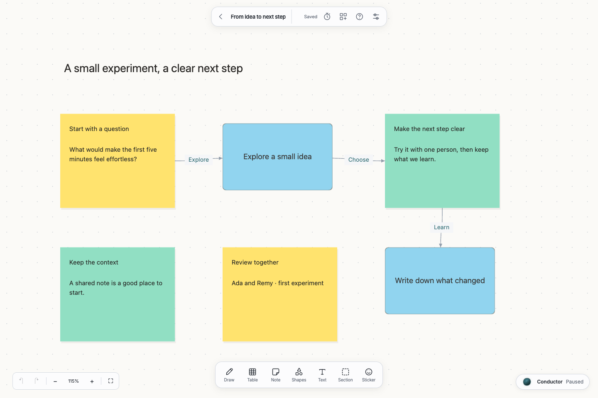

# Start here

Hanji gives ideas, next steps and knowledge a shared workspace. **Think** is the
canvas. **Plan** holds issues, projects and objectives. **Document** reads and
edits your Markdown. The conductor brings an agent into context when you need one.

This public handbook describes the current working preview. The Mac app is
shared by invitation; public binary downloads and a hosted workspace service
are not available yet. [Request preview access](https://hanji.ink/start/).

## Make a workspace

[[Desktop workspace]] covers receiving the preview, moving the app to
Applications and creating a workspace. The setup has four stages: your workspace,
your content, secure access and a review. Start fresh prepares the selected
products’ folders; existing content can be connected during setup or later.

[[Quick start]] helps you choose that path or the path for an existing source
checkout. You can read, edit and organize without connecting a model account.

## Find the surface you need

| You want to | Start here |
|---|---|
| Explore an idea visually | [[Think canvas]] — live notes, diagrams, tables, templates and workshops |
| Turn the next step into work | [[Objectives and key results]] — goals, key results and linked work in Plan |
| Read, write and keep knowledge | [[Reading and writing]] — Markdown pages, comments, history and search |
| Work with your own agent | [[The conductor]] — a standing conversation across the workspace |
| Understand what has moved | [[Workspace insights]] — contributions, trends and the journal |
| Share with your team | [[On your tailnet]] — access through a network you operate |
| Publish chosen content | [[Publish to the web]] — this handbook, HTML, Markdown and llms.txt |

## Go a little deeper

[[Using Hanji]] is the complete guide map. [[Features]] lists what the preview
implements. [[Permissions]] explains who can read and change each kind of content.
[[Mounts]] connects repositories, [[Agents]] connects scoped tools, and
[[Proposals]] covers reviewing suggested edits.

For the project’s direction, read [[The story]], [[Principles]] and
[[Where we are]]. For the implementation, start with [[How it's built]],
[[The serializer]], [[The core]] and [[The web front]].

The products were previously called Write and Work. Their current names are
Document and Plan; technical package and command identifiers stay stable.
